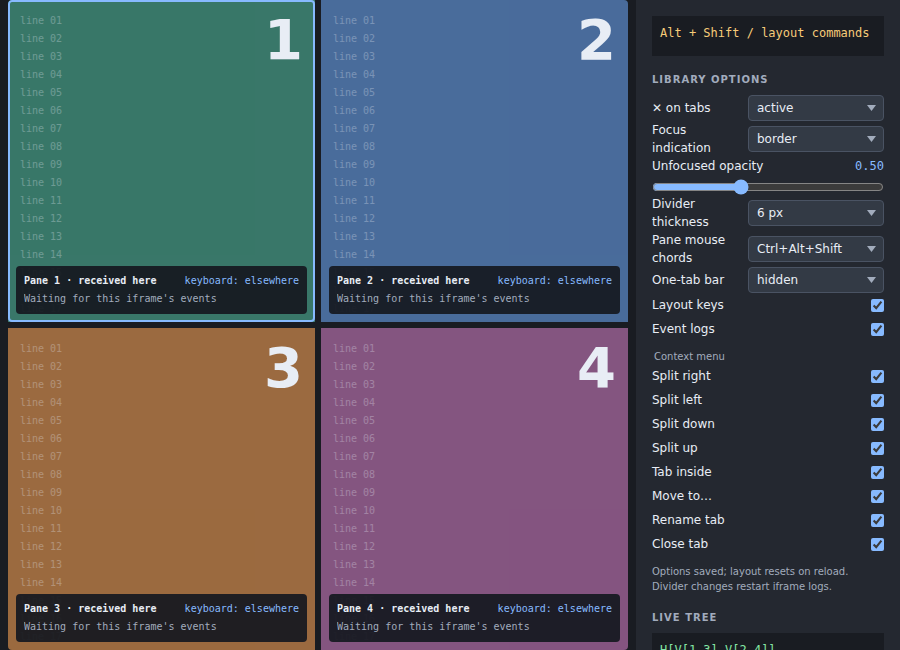
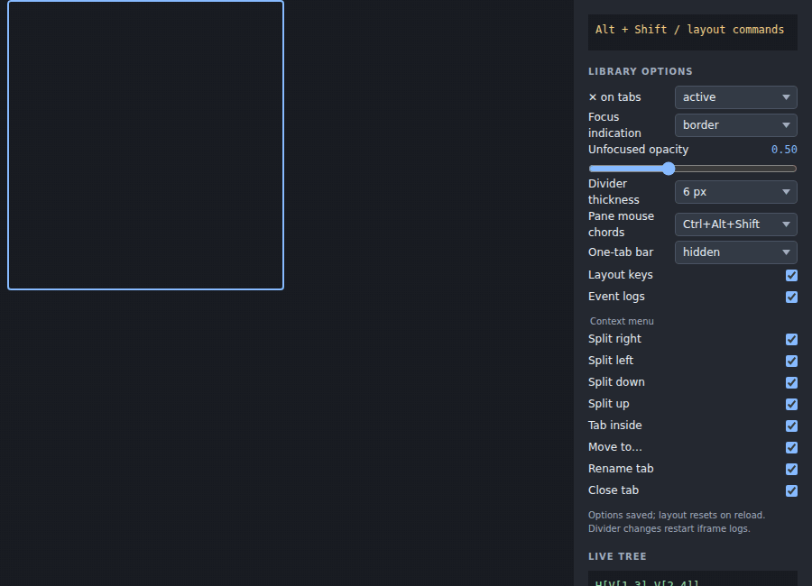
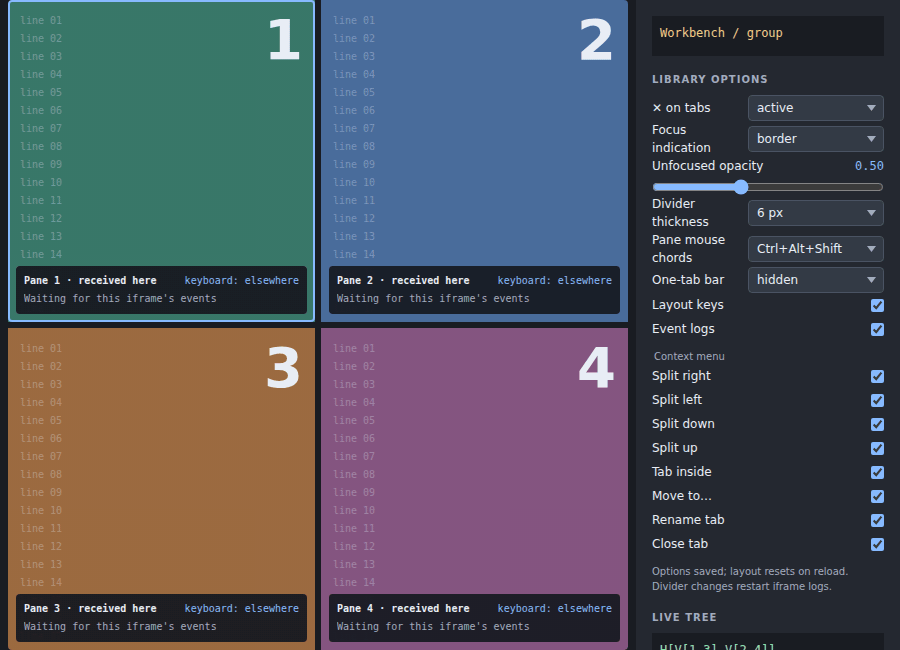
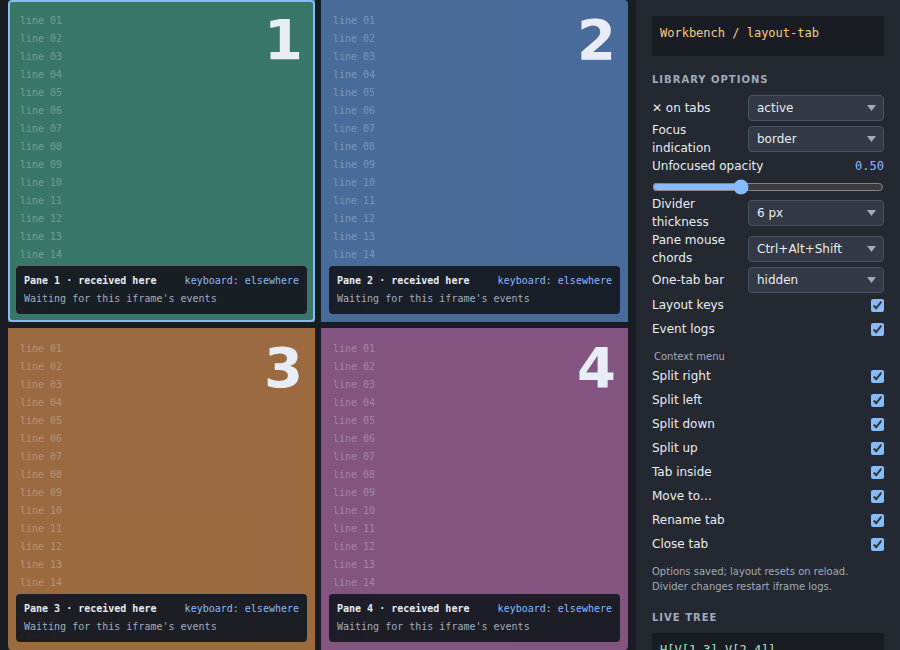
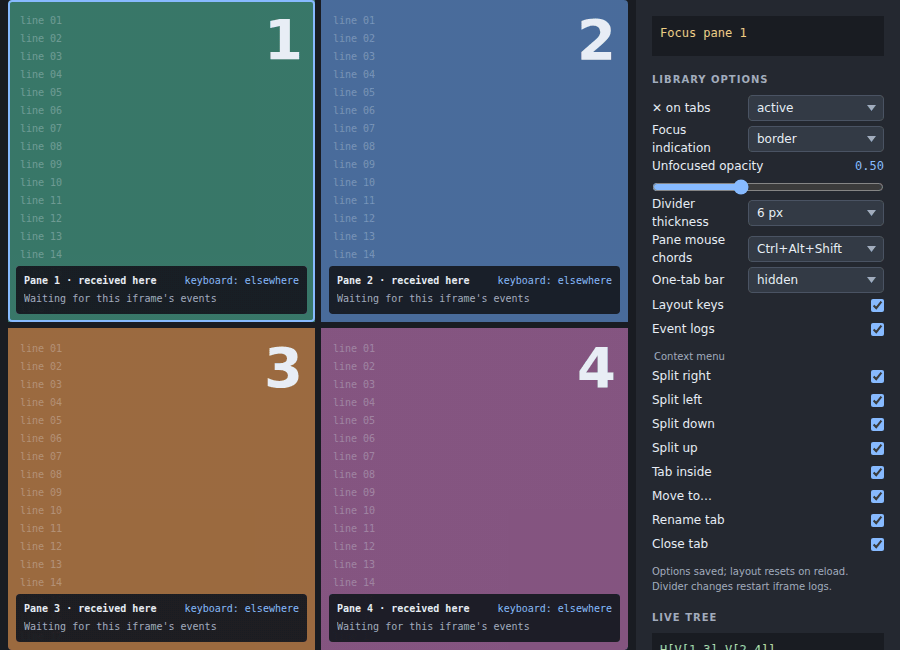
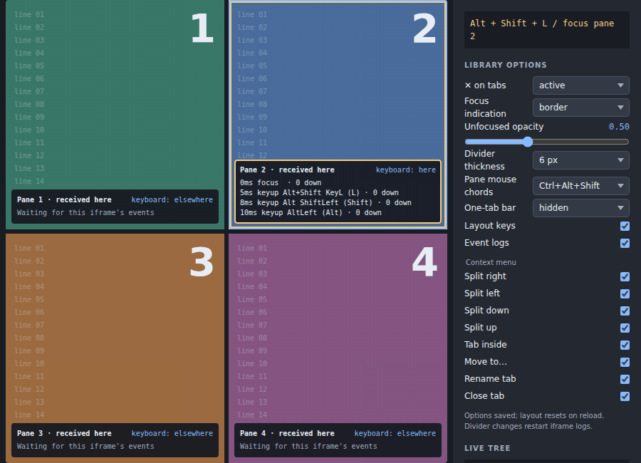

#+TITLE: @0k/vue-split-tabs

Documentation website: [[https://0k.github.io/vue-split-tabs/][the extended guide and live Workbench]].

* Purpose

=@0k/vue-split-tabs= is a content-agnostic Vue 3 split and tab layout. The
controller owns saved intent, the layout algebra, and the effective layout;
components render that layout and handle gestures. Hosts own views, labels,
storage keys, routing, data, themes, and key bindings.

It preserves Keep content while views move, collapse, zoom, and restore. A
host supplies every visible label: the library has no built-in strings, and a
control with no label is hidden.

* Vocabulary

- A *view* is one host tab id, or a controller-created *placeholder* whose id
  starts with ~placeholderPrefix~. Fill a placeholder with host content using
  ~replace(placeholder, id)~.
- A *tab set* is a tab bar and the tab it shows. A tab holds a view, a
  *layout* (a cut), or another tab set (an *inner bar*).
- A *pane* is the content area of a tab set showing a view. The *bar* sits
  outside the pane, beside it. A *frame* is a tab set showing a layout or
  inner bar; its bar sits outside its frame content too.
- A *cut* divides an area into ~rows~ (stacked) or ~cols~ (side by side), with
  a divider. Splits name where the new part goes: ~left~, ~right~, ~top~, or
  ~bottom~, never “vertical” or “horizontal”.
- *Focus* is one pane; *selection* is several panes; *group* rebuilds cuts so
  a selection becomes one node; a *scope* is the area in which a pane is a
  tile; *bar focus* is the tab bar whose label was last clicked.

Commands target the selection, grouped first, or otherwise the focused pane.
~tabNext~ adds a new tab next to the target; ~tabInside~ puts a new inner bar
in the target's place.

Use the exported ~notation(tree)~ or reactive ~controller.notation~ to inspect
a layout. ~H[a b]~ means side-by-side, ~V[a b]~ means stacked, and ~(a *b)~ is
a bar of views showing ~b~. A bar holding a layout is ~T{H[a b] | *c}~.

The algebra preserves the pictured arrangement while regrouping. For example:

- Grouping the top row of ~H[V[1 3] V[2 4]]~ produces
  ~V[H[1 2] H[3 4]]~.
- ~tabNext~ on that selected top row produces
  ~V[T{H[1 2] | *5} H[3 4]]~.
- In a two-tab left bar, ~tabInside~ on view ~1~ produces
  ~T{*(1 *3) | 2}~: the new bar is inside that tab, not beside the outer bar.
- Splitting a selection places a placeholder beside the whole group, rather
  than splitting just the last pane that received focus.

* Demo

The offline *Workbench* demonstrates split and tab layouts with coloured,
numbered iframe views, live library options, keyboard and touch gestures, a
tree readout, and a keycast showing the last chord or gesture. Every layout
action uses the public built package; the demo supplies content, labels, and
the dark theme. Its iframes cooperate through the separate frame helper and
stay mounted through moves and zoom. Neither ~demo/~ nor ~doc/~ ships to npm.

Each iframe shows its own ordered event log, keyboard-focus indicator, and
gesture meter. The compact *Library options* panel changes tab close buttons,
focus borders and dimming, divider thickness, pane mouse chords, single-tab
bars, context-menu items, layout keys, and event logs without reloading.
Focus and selection are the library's own marks, drawn above iframe content.

Only these options persist in localStorage. The layout uses in-memory storage
and every reload starts at ~H[V[1 3] V[2 4]]~. Changing divider thickness keeps
the current layout but recreates its controller and iframes, resetting their
local logs. The layout starts at the top of the page.

Workbench pane clicks and drags default to Ctrl+Alt+Shift; Alt+Shift clicks
belong to content. Choosing the library-default mouse chords restores
Alt+Shift click/drag and Ctrl+Alt+Shift rectangle clicks. With layout keys
enabled, Ctrl+Alt+Shift+arrows extend selection; an arrange-mode long press
also selects rectangles.

#+begin_src sh
npm run demo
#+end_src

[[https://github.com/0k/vue-split-tabs/blob/main/demo/acceptance.org][demo/acceptance.org]] maps each Workbench feature to the named real-input
scenario of ~npm run demo:test~ that proves it.

** Clips

Run ~npm run demo:capture~ to regenerate these short looping clips. Each
shows one capability with its chord or gesture in the top-right keycast.

The base Workbench: four numbered views, library options, and the live tree.

#+ATTR_HTML: :alt Workbench with four numbered iframe views and live layout options

- *Split*: Alt+Shift+E/O split right/below, a dragged divider snaps onto a
  parallel divider, and a double press equalizes thirds.

#+ATTR_HTML: :alt Split panes, snap dividers and equalize their sizes

- *Group*: Ctrl+Alt+Shift+click selects a row with a green preview; Alt+Shift+G rebuilds
  the tree; a diagonal selection is refused in red.

#+ATTR_HTML: :alt Group a rectangular selection and refuse a diagonal selection

- *Layout tab*: Ctrl+Alt+Shift+click selects all four panes; Alt+Shift+T keeps the
  layout in one tab beside a new view, then click back to that layout.

#+ATTR_HTML: :alt Keep an entire pane layout together inside a tab

- *Inner tab*: Alt+Shift+I and a middle drop create an inner bar, while a
  drop on a bar places the view next to its other tabs.

#+ATTR_HTML: :alt Create inner tabs or place tabs beside existing tabs

- *Drag*: a pane's edge quarter splits that pane, the outer edge splits
  the whole area, and resting on a hidden tab spring-loads it open.

#+ATTR_HTML: :alt Drag views to split edges and spring-loaded tab destinations

- *Bars*: Alt+Shift+R cycles the bar through left, bottom, right, and top,
  and dragging a left bar's inner edge changes its width.

#+ATTR_HTML: :alt Rotate tab bars and resize a side bar

- *Zoom*: Alt+Shift+Z zooms the focused pane and restores the exact layout.

#+ATTR_HTML: :alt Zoom a pane and restore the original layout

- *Close*: drop a view in the bin or close a pane with Alt+Shift+X, then
  Undo restores what was closed.

#+ATTR_HTML: :alt Close a view in the bin and restore it with Undo

- *Keyboard*: H/J/K/L chords move focus, Alt+Shift+M selects by letter,
  and Alt+Shift+V plus a destination letter and arrow moves a pane.

#+ATTR_HTML: :alt Focus, select and move panes with keyboard chords

- *Touch*: on a tablet-sized viewport, a native four-finger hold enters
  arrange mode, taps select, a drag moves, and four-finger pinches zoom/restore.

#+ATTR_HTML: :alt Arrange panes with touch and zoom with four-finger pinches

* Install and usage

#+begin_src sh
npm install @0k/vue-split-tabs
#+end_src

Vue ~^3.5.3~ is an external peer and the package is ESM-only. Import the CSS
once: JavaScript and declarations do not import it implicitly. Give the root a
definite height.

Published component types work with TypeScript ~moduleResolution: "bundler"~
and ~moduleResolution: "NodeNext"~; both supported and tested with strict
consumer probes. The declaration build qualifies Vue SFC references with
~.vue.js~ so both resolvers find the emitted ~.vue.d.ts~ files.

The ~controller~ prop is read once when ~SplitTabs~ mounts. To swap controllers,
remount the component with a changing ~:key="controllerKey"~ alongside
~:controller="controller"~; changing the prop alone does not replace it.

#+begin_src vue

<template>
  <button type="button" @click="fillPlaceholder">Create outline</button>
  <button type="button" @click="controller.open('frame')">Open frame</button>
  <SplitTabs :controller="controller" :labels="labels" :strip-labels="stripLabels"
    @command="command">
    <template #tab="{ id, title }">{{ title ?? id }}</template>
    <template #pane="{ pane }">
      <SplitTabsAnchor part="body" />
    </template>
    <template #keep>
      <SplitTabsKeep v-for="tab in tabs.filter(t => t !== 'frame')" :key="tab" :tab="tab" part="body">
        
{{ tab }} content supplied by the host

      </SplitTabsKeep>
      <SplitTabsKeep tab="frame" part="body" overlay>
        <iframe title="Host-owned frame" src="/host-frame" />
      </SplitTabsKeep>
    </template>
    <template #undo="{ undo, dismiss }">
      <button type="button" @click="undo">Undo close</button>
      <button type="button" @click="dismiss">Dismiss</button>
    </template>
  </SplitTabs>
</template>
#+end_src

The library renders every tab set's bar outside its pane or frame content.
The ~#pane~ slot supplies CONTENT ONLY: never render a ~SplitTabStrip~ there.
The optional ~#frame~ slot adds an absolutely positioned layer over the frame
content area. It takes no layout space and neither replaces the recursive
layout nor renders a bar. The layer defaults to ~pointer-events: none~; set
~pointer-events: auto~ on host controls that should receive presses.
~SplitTabsAnchor~ identifies where a ~part~ of
Keep content is placed. ~#keep~ is instantiated once, so each
~SplitTabsKeep~ stays mounted. Ordinary Keep content teleports to the visible
anchor. ~overlay~ Keep content is teleported once into the root layer and
positioned over its anchor, which avoids moving and reloading an iframe. An
overlay Keep registers its part, so every matching anchor gets the flex layout
needed to occupy its pane.

* Behavior contract

** Layout model and grammar

Intent is ~{ version: 3, tree, focus, opened, titles? }~, with optional
~titles: Record<string, string>~ keyed by a view id or a layout/inner-bar node id.
Existing version-3 layouts without titles stay valid (no version bump).
Blank titles and titles whose keys are absent from the tree are dropped on read,
before new node or placeholder ids are allocated.
Titles follow keys through moves. New grouping nodes inherit no title;
dissolved or closed keys lose their titles on the next write. Replacing a
placeholder drops its title rather than copying it to the real view. Close
undo restores the titles too. The unlimited-depth tree
contains cuts and tab sets; node ids and view ids are unique and never reused
within one controller lifetime, including ids read from storage. A tab set with
one nested tab set dissolves into that tab; a nested one-tab bar is replaced by
its tab; bars with two or more tabs never merge.

A bar with one tab is hidden by default, even in a split layout. Set
~alwaysShow~ on ~SplitTabs~ to show it. Bars may be ~top~, ~left~,
~bottom~, or ~right~; left and right bars are vertical and have a persisted,
resizable ~barWidth~.

~alwaysShow~ accepts a boolean (default ~false~) or
~(tabSet: SplitTabsTabSet) => boolean~. The policy receives the tab set;
use its identity or tabs, not measured geometry, to choose individual bars.
An ~alwaysShow~ policy must not read the controller: projection-derived
reads throw a ~split-tabs:~ error during projection evaluation. To show bars
only when split, compute a boolean in the host render instead:
~:always-show="controller.hasSplit.value"~.
~hasSplit~ counts visible panes in the unzoomed folded working tree, before
size collapse; zoom does not change it. ~isSplit~ instead describes the
rendered layout, after zoom and collapse. Never drive ~alwaysShow~ from
rendered-layout values (~isSplit~, ~panes~, ~fits~, ~layout~, etc.), even
through a host-render boolean: visible bars change minima and can make that
layout alternate forever between split and collapsed.
This presentation policy never writes storage. It also feeds size collapse,
divider clamps, keyboard nudges and equalization: each visible bar counts in
its tab set's minimum, including bars beside view panes, not just frames.

Customize the bar with ~#tab { id, active, kind, views, title }~ and extra controls
in ~#bar-start { tabSet }~ / ~#bar-end { tabSet }~. These slots receive the
effective ~SplitTabsTabSet~ object. End controls hide with the bar. When an
add button must remain available, request a bar for that tab set:

#+begin_src vue
<SplitTabs :controller="controller" :labels="labels"
  :always-show="tabSet => canAdd(tabSet.id)">
  <template #tab="{ id, kind, views, title }">{{ title ?? (kind === 'view' ? id : views.join('+')) }}</template>
  <template #bar-end="{ tabSet }">
    <button type="button" @click="addTo(tabSet.id)">+</button>
  </template>
  <template #pane><SplitTabsAnchor part="body" /></template>
</SplitTabs>
#+end_src

Here ~canAdd~ and ~addTo~ are host functions. A requested bar is simpler
than a second hidden-bar control location: one slot, one owner and one
minimum-size policy. With the bar hidden, no space is reserved and the pane
fills the entire tab-set box.
Inline arrows such as the example above are safe when the HOST RENDER reads
the controller's computed members, not the policy itself: a fresh function
identity with unchanged results does not invalidate the layout. Changing the policy's
results updates bars live. Bar-side commands target a shown one-tab bar too,
including the bar whose label was last clicked.

** Intent, identity and effective layout

Persist ~intent.tree~, not the effective layout. The effective ~layout~ is a
projection for the current container: it has panes, frames, and cuts with
geometry. ~SplitTabsPane~ has an id, visible tab keys, shown view, index,
~fits~, and ~collapsed~ flag. A collapsed pane represents a whole subtree.
Effective ~width~/~height~ metadata describes the outer tab-set allocation,
including its bar; measure ~[data-pane-id]~ for the actual content rectangle.

Size collapse is top-down and never writes intent: when a cut cannot fit two
minimum panes, their visible bars and its divider, its subtree renders as one pane listing its
visible views. Its exact tree returns when space returns. Divider drags and
keyboard nudges clamp against the same full subtree minima, including every
visible bar and divider. A nudge that cannot move returns ~at-limit~ without
writing storage; derived size, host tab-list changes, and host
navigation do not write storage.

Visible views are placeholders, or present non-optional views, or opened
optional views. Present visible host views absent from the tree are derived in
the first pane after their nearest placed natural predecessor. Absent views
keep their place. A pane click or ~focusPane~ saves a changed focused view immediately.
Directional keyboard focus via ~focusDirection~ stays in memory until the next write.
Selection, bar focus, and zoom are memory-only. The host ~active~ binding follows the
focused pane's shown view; a visible host request reveals its path without a
write. The getter may catch up with ~set~ later, as an asynchronous router
does: until it shows the last value set, the values it passes through (the
one it showed before, and those set since) are not host requests.
If an action requests the value the getter already shows, pending values stay
protected across Vue ticks for up to 250 ms, or until the getter acknowledges
the latest request or supplies a new value. The bounded delay also handles
routers that cancel the earlier request and drop the duplicate without changing
their getter; later host navigation is honoured after that delay. ~dispose()~
clears this fallback timer.

** Commands and the target

Commands act on the selection after grouping it when possible, otherwise on
the focused pane. ~split(side)~, ~tabNext()~, and ~tabInside()~ create fresh
placeholders for the host to replace. ~group()~ refuses a non-rectangular
selection with ~not-groupable~ and the panes in the way. Layout-changing
commands restore zoom first; zoom itself is memory-only except for any grouping
needed to form its target.

~closeTarget()~ closes only optional views and placeholders. If any visible
view is non-closable, the whole close is refused with ~not-closable~. Closing
leaves a one-shot undo snapshot; the root exposes it through ~#undo~ for
~undoTimeout~ milliseconds after each close (~undoSerial~ rises with each one,
so a later close starts the wait again). ~cycleBarSide()~ cycles a visible target bar
through top, left, bottom, and right.

** Drop zones and moves

The drag model is shared by internal and external drags. A tab-bar drop adds
the item next to the other tabs at its marker. A pane middle drop adds it
inside, creating an inner bar. A pane outer quarter splits that pane. A thin
frame band splits beside the framed tab set, and a root band splits the whole
area. The bin, shown while dragging, closes an internal dragged view, pane, or
selection.

~move(source, zone)~ accepts a view, a node, or the current selection. A
selection is grouped first. ~canMove~ is the non-mutating dry run, including
prospective external view ids before host registration. Moves and
drop results are atomic; an invalid target changes nothing.

Dropping a pane or its SHOWN tab's label on its OWN outer quarter splits
INSIDE the shown tab in equal halves. Its content goes on the dropped side,
and a fresh placeholder fills the opposite side; the bar keeps its other tabs
and shows the new layout tab. For example, an own-right drop in ~(A *B)~
produces ~T{A | *H[new:1 B]}~: A stays untouched, and switching back to B's
layout restores the split. A one-tab set normalizes to ~H[new:1 B]~. Focus goes
to the new placeholder, consistently with ~split()~. The host fills it through
~replace~ as usual. A pane drag onto its own middle is refused (~into-itself~).
Dragging a lone tab label onto its own middle or bar instead returns
~nothing-to-move~. Both refusals leave intent and storage unchanged.
The only visible tab follows the shown-tab rule, preserving hidden siblings
outside the new layout tab.
Frames keep their whole tab set on their existing own outer-band drops.
A NON-shown label dropped on its own pane edge still separates just that
tab without creating a placeholder: it is not the content being shown. Selections self-split
only when their grouping plan is ~single~; dropping a larger group onto a
member remains refused. No other layout-grammar rule changes.

Both equal halves must fit their subtree minima (including bars) and the
divider; otherwise ~canMove~ and ~move~ return ~no-room~ without changing
intent or writing storage. Successful moves still write once; undo remains
the existing close-only snapshot. This rule is shared by arrange touch drags,
mouse pane-chord drags, keyboard move (own letter then arrow), tab-menu direction actions,
and the API.

Self-drop previews show the content side with ~.split-tabs-drop-shade~ and
the opposite half with ~.split-tabs-drop-shade.split-tabs-drop-preview--new~.
Both receive ~data-refused~ on refusal. The latter has a distinct background
and inset shadow, styled through ~--split-tabs-drop-new-background~ and
~--split-tabs-drop-new-shadow~; its optional text is ~labels.newPane~. Without
that host label it has no text: the library supplies no wording.

** Keyboard

Key bindings belong to the host. ~SplitTabs~ defaults its ~keymap~ prop to
~defaultKeymap~; pass a changed map, spread and override ~defaultKeymap~, or
pass ~null~ to bind nothing. Commands remain callable through controller
methods and the root component ref's ~run(command)~. The ~command~ event gives
the command and a structured result; hosts supply any displayed wording.

On a focused tab label, Alt+Shift+Left/Right reorders horizontal bars and
Alt+Shift+Up/Down reorders vertical bars. This is tab-bar reordering, not a
layout command.

** Tab context menu

Every tab is renamable by default, including layout and inner-bar tabs.
Double-click a label to replace it with an inline input. Its value is the
current custom title (empty when unset); Enter or blur commits, Escape
cancels without exiting arrange or another layout mode. Leaving the strip or
unmounting the editor commits an unfinished edit exactly
once, like blur. Pane pickers leave the editor's typing and Enter alone;
modifier releases still update the shell's pane covers. Whitespace is trimmed;
empty clears the custom title. ~SplitTabs.renamable~ accepts a boolean or
~(key: string) => boolean~, default ~true~; false hides rename menu items
and disables double-click editing. This is a UI policy, not an API restriction.
Root ~labels.renameInput?: string~ supplies only the input's accessible name;
there is no built-in placeholder, label or visible string.

Hosts with their own tab menu can call the root component ref's
~startRename(key: string): boolean~ to open that same inline editor, initialized
with the current title. It returns false for an unknown key, a key disabled by
~renamable~, or a tab without a rendered, visible bar (including a hidden
single-tab bar). On false, the host should fall back to its own prompt and
commit through ~controller.rename(key, title)~. Starting an edit does not write
storage; committing reports ~command('rename', result)~ as usual.

Pass ~menuLabels: SplitTabsMenuLabels~ to ~SplitTabs~ to enable its one
~SplitTabsMenu~. All wording belongs to the host. A missing item label hides
that item; no labelled available items leaves right-click to the browser.
Right-click opens at the pointer. A touch/pen hold arms at 350 ms; lifting
without dragging opens the menu there, while movement starts the normal drag.
On a focused label, ContextMenu or Shift+F10 opens below the label. Placement
flips and clamps inside the window, including after resize.

| Label key | Control / meaning |
|-----------+-------------------|
| ~menu~ | Menu accessible name |
| ~right~, ~left~, ~down~, ~up~ | Split toward that side: a lone visible tab self-splits, as does any shown tab, inside its shown entry with an opposite placeholder; a non-shown tab separates alone |
| ~inside~ | Move the tab inside its tab set's shown content, only if ~canMove~ allows it |
| ~move~ | Numbered destination picker (three or more panes) |
| ~otherPane~ | Move to the other pane (exactly two panes) |
| ~close~ | Close, offered only when ~isClosable(tab)~ |
| ~rename~ | Start inline editing, offered only when renamable |
| ~noRoom~ | Disabled reason for ~no-room~ |
| ~onlyTab~ | Disabled reason for ~nothing-to-move~ or ~into-itself~ |

~menuItems?: readonly SplitTabsMenuItem[]~ controls order and subset. Default:
~['right', 'left', 'down', 'up', 'inside', 'move', 'rename', 'close']~. An empty array
disables the default items. The ~move~ item uses ~otherPane~, not ~move~, in
the two-pane case. Hover or focus on ~move~ previews pane numbers; activating
it (or pressing M) starts ~useSplitTabsPick().start(tab)~. Digits 1–9 also
choose a numbered destination directly while the menu is open. The picker
is shared with the root's other move controls.

ArrowUp/Down cycle enabled items, Enter/Space activates a focused button,
and the unified exit keys or outside press close and restore label focus. The menu has
~role="menu"~; items are buttons with ~role="menuitem"~.

Append host actions through ~#menu-extra="{ tab, tabSet, close }"~ on the
root. Give those buttons ~role="menuitem"~ and ~class="split-tabs-menu-item"~
to share keyboard navigation and styling, and call ~close()~ after acting:

#+begin_src vue
<SplitTabs :controller="controller" :labels="labels"
  :menu-labels="{ menu: 'Tab options', right: 'Split right', close: 'Close' }"
  :menu-items="['right', 'close']">
  <template #menu-extra="{ tab, close }">
    <button type="button" role="menuitem" class="split-tabs-menu-item"
      @click="inspect(tab); close()">Inspect</button>
  </template>
</SplitTabs>
#+end_src

The exported ~SplitTabsMenu~ also accepts ~controller~, ~tab~, ~tabSet~,
~anchor: HTMLElement~, optional ~point: { x, y } | null~, ~labels~ and
~items~, ~renamable~ (same policy, default true), exposes ~#extra { tab, tabSet, close }~,
and emits ~close~ and ~rename(key: string)~. The root handles rename by opening
its bar's editor; standalone hosts handle that event themselves. Strips
inside a root normally open the root-owned instance automatically.

** Touch and arrange mode

Touch is first class. A label touch or pen press holds before dragging; a
movement before arming is left to browser scrolling. Four-finger hold toggles
arrange mode; holding a divider still also toggles it. Four-finger pinch out
zooms the pane under the fingers (or the selection), and pinch in restores.
The ~arrange~ command toggles the same mode.

From the third finger a touch sequence belongs to the layout. Each root counts
only touches starting inside it and reports from its own iframes, never fingers
in other roots or host content. The library
cancels ~touchstart~ and ~touchmove~ while three fingers or more are down, so
the browser never starts its own pan or zoom and the content under the
fingers does not scroll, and it covers every pane (the arrange-mode cover)
until all fingers lift, so taps and moves reach neither page content nor
iframes. One and two fingers stay with the content (scrolling, pinch-zoom);
what they did before the third finger landed cannot be undone. Touch events
are the source of truth. Touch pointerdowns and iframe down reports count as
provisional fingers and arm the owning document's blocker immediately:
Chromium routes touches to the first finger's document, even when later
fingers land elsewhere. Touch snapshots replace the hints; pointer up/cancel
drops only hints not yet reported by touch events. Android System WebView's
~pointercancel~ therefore cannot break a continuing touch hold or pinch.
Other-document touches are checked against this root's geometry, so fingers
outside it never count. The cancelling
listener is non-passive only while at least two fingers remain, and is removed
after 2.5 seconds of touch silence or on disconnect/unmount, so one-finger
scrolling never waits for the page. While the modifiers of an enabled
pointer chord are held (see ~pointerChords~) or arrange mode is active, panes
are covered above overlays so layout clicks and drags reach the shell; every
other press focuses its pane and stays with the content.

Every modal mode has library-owned keyboard exits, independent of the host's
~keymap~: ~exitKeys?: readonly string[] | null~ defaults to
~['Escape', 'Ctrl+KeyG', 'Ctrl+KeyD']~ (also exported as ~defaultExitKeys~).
Pass ~[]~ or ~null~ to disable, or supply physical chords with the same strict
validation, exact modifiers and AltGraph exclusion as keymaps. While a mode
is active, the library captures these keys on ~window~ before page content:
Arrange exits together with its drag (including armed presses), menu or picker.
The inline title input owns its typing keys: Escape cancels its edit only.
Outside arrange only the innermost mode exits per press. Keydown, held repeats and keyup are
cancelled and stopped, including immediate propagation. Capture listeners
are removed after the mode and its consumed release end, and on unmount.
Without a mode, exit keys alone do not take any input, including in iframes;
separate command bindings still apply. ~clear~ clears selection or bar focus,
not modal state.

Arrange mode isolates the entire page: capture-phase keydown/keyup, pointer,
mouse, click/double-click/context-menu, wheel and touch events are cancelled
with both propagation stops. Only the library's own arrange UI (covers, bar
labels, menus, bin, ~#undo~ and ~#arrange~ slots) receives interaction; content and pane
iframes receive nothing. Pane letters toggle selection, skipping ~q~.
The bound ~arrange~ chord exits the mode (Alt+Shift+A by default); other layout
chords stay swallowed. Tab/Shift+Tab cycle enabled controls in the host Done
slot, library menus and undo slot, never page or pane content or the
pointer-only drag bin. The inline
rename editor retains its own typing keys and Escape.
~arrangeExitKeys?: readonly string[] | null~ adds arrange-only exits to
~exitKeys~ (default ~['KeyQ']~; ~[]~ or ~null~ adds none). Plain physical Q
and the bound arrange toggle are controls, not content input. Invalid
~arrangeExitKeys~ chords throw at mount, like invalid ~exitKeys~.
Plain Q exits arrange by default, never letter-selects a pane. Every exit,
including ~done()~, command toggle and four-finger hold, clears selection and
bar focus. Outside arrange, ordinary input behavior is unchanged.

~labels.arrangeMenu~ enables the bottom-right arrange-menu button (hidden
while dragging so it never overlaps the bin). ~arrangeMenuLabels~ supplies
labels for ~splitRight~, ~splitLeft~, ~splitBelow~, ~splitAbove~, ~tabNext~,
~tabInside~, ~group~, ~zoom~, ~restore~, ~barSide~, ~close~, ~undo~, ~done~.
Missing labels hide items; ~restore~ replaces ~zoom~ when zoomed. Its optional
~reasons: Partial<Record<SplitTabsReason, string>>~ words disabled refusals.
~arrangeMenuItems?: readonly SplitTabsArrangeMenuItem[]~ controls order and
subset; default order is the preceding list without ~restore~ (which is a
label, not an item). Group appears with at least two selected panes, Undo
only when available. Commands act on the selection, else the focused pane;
splits create placeholders, not host views. ~controller.canTarget(command:
SplitTabsTargetCommand): SplitTabsResult~ previews these commands without
writing intent or allocating real ids.

Use the existing ~#arrange { run, done }~ slot for a visible host-labelled
“Done” control; ~done()~ ends arrange mode and clears selection/bar focus.
The host can position ~.split-tabs-arrange~ and size/style its own button,
including an icon. No label is built into the library:

#+begin_src vue
<template #arrange="{ done }">
  <button type="button" @click="done">Done</button>
</template>
#+end_src

** Iframes

Iframes do not bubble their events to the shell. Use the separate
~@0k/vue-split-tabs/frame~ entry from inside an iframe; its helper forwards
presses, keys, and touch reports. The shell accepts reports only from iframes
inside its root and allowed ~frameOrigins~ (its own origin by default). A
2.5-second silence clears reported fingers.

** Storage

Storage is one LRU table under ~storageKey~, with entries
~{ key, stamp, intent }~. It refreshes and validates before each write,
replaces only the current ~entryKey~, and preserves in-memory operation when
storage throws. Changed user actions write once; untouched new keys create no
entry. 0.2 trees and 0.1 two-pane entries migrate on read to equivalent tab
sets. ~dispose()~ stops controller watchers.

* API

** Breaking changes from 0.2.x

| Before | 0.3 |
|--------+-----|
| ~place~, ~moveTo~, ~split(id, orientation, pane)~, ~splitAt~, ~insertSplit~, and ~insert(id, pane, beforeId)~ | Replaced by ~move(source, zone)~, ~canMove(source, zone)~, and ~insert(id, zone, register?)~; commands create placeholders. |
| ~select(pane, id)~ where pane was a pane only | ~select(tabSet, key)~ keeps selection semantics; a tab set can be any visible bar. |
| ~intent.order~, ~intent.firstActive~, and ~intent.ratio~ | Removed; intent is v3 ~{ version, tree, focus, opened, titles? }~. |
| ~canOfferSplit~ and ~ratio~ controller members | Removed; use effective ~fits~, ~cuts~, and explicit cut methods. |
| ~defaultRatio~ option | Removed; ratios live in the cut tree. Use ~commitRatio(ratio, cut)~ to resize a cut or ~equalize(cut)~ to balance it. |
| ~dividerSize: 0~ | Values below 1 now throw at controller creation; choose a thickness of at least 1 px. |
| ~PaneNode~ type export | Replaced by ~TabSetNode~; a tab set holds views, layouts, or other tab sets. |
| Host-rendered ~SplitTabStrip~ inside ~#pane~ or ~#frame~ | Remove it. ~SplitTabs~ renders all bars outside content; move labels, ~closeButton~, ~alwaysShow~, ~tabClass~, ~iconClass~ and ~#tab~ to the root. |
| Strip ~#end~ host controls | Move to root ~#bar-end="{ tabSet }"~; ~#bar-start~ provides the other end. Request ~alwaysShow~ for any set whose controls must remain visible. |
| Pane selectors included the bar | ~.split-tabs-tabset[data-tabset-id]~ is the whole box; ~.split-tabs-bar[data-bar-id]~ is its bar; ~.split-tabs-pane[data-pane-id]~ is content only. |
| Standalone ~SplitTabStrip~ prop ~pane~ | Renamed to ~tabSet~; standalone use only, not inside root content slots. |
| ~labels.rows~ / ~labels.cols~ and per-tab split buttons, ~splitButtons~, ~--split-tabs-icon-size~, ~--split-tabs-icon-hit-size~ | Removed: split by dragging a tab, by the keymap, or by the tab context menu. |
| ~startExternalDrag(event, id, ghost, labels, beforeDrop)~ | ~startExternalDrag(event, id, ghost, beforeDrop)~. |
| Old ~TabDropTarget~ | Now carries a ~bar~, ~inside~, ~split~, or ~bin~ target plus its checked result and preview geometry. |
| ~.split-tab-strip-marker[data-before]~ and ~--split-tabs-marker-width~ | Removed; style ~.split-tabs-drop-shade[data-marker]~ with ~--split-tabs-marker-color~. Geometry sets its size. |
| ~SplitSide~ | Removed in favour of ~Side~ (union below). |
| ~paneKey~ | Replaced by tab-set injection; descendants use their containing tab set. |
| Centre pane drop moved to another pane | Centre drop creates an inner bar inside the zone. |
| One-tab bars shown when split | Hidden by default; use ~:always-show="controller.hasSplit.value"~ on ~SplitTabs~ to show bars when the unzoomed working tree is split, even if size-collapsed. |

Existing stored 0.1 and 0.2 data migrates when read, but TypeScript callers
must move to the tree and zone APIs.

~Side~ is ~'top' | 'right' | 'bottom' | 'left'~.

** Controller options

| Option | Type / meaning |
|--------+----------------|
| ~tabs~ | Required ~MaybeRefOrGetter<readonly string[]>~ of host ids in natural order. |
| ~optional~ | Optional ~MaybeRefOrGetter<readonly string[]>~, a subset of ~tabs~; hidden until opened and closable. |
| ~active~ | Optional ~{ get(): string; set(id: string): void }~ binding for the focused view; ~get~ may lag behind ~set~. |
| ~entryKey~ | Required ~MaybeRefOrGetter<string>~ page identity. |
| ~storageKey~ | Required storage-table key. |
| ~storage~ | Optional ~SplitTabsStorage~ with ~getItem~, ~setItem~, and ~removeItem~. |
| ~maxEntries~ | LRU capacity; default 50, minimum 1. |
| ~minPaneWidth~, ~minPaneHeight~ | Required pane minima in pixels. |
| ~dividerSize~ | Divider thickness in pixels, at least 1 (smaller, ~NaN~ or infinite values throw at creation); default 6. The grab zone stays at least 8 px. |
| ~barThickness~ | Actual top/bottom bar thickness, including padding; default 32. Included in collapse and divider minima. |
| ~sideBarWidth~ | Default left/right bar width; default 96. |
| ~snap~ | Grouping alignment tolerance in pixels; default 40. |
| ~placeholderPrefix~ | Prefix for controller-created views; default ~split-tabs:new-~. |

** Controller members

Reactive ~ComputedRef~ members are ~layout~, ~panes~, ~frames~, ~cuts~,
~tabSets~, ~isSplit~, ~hasSplit~, ~orientation~, ~fits~, ~focus~, ~selection~, ~plan~,
~barFocus~, ~zoomed~, ~canUndo~, ~undoSerial~, ~restoredActive~, ~opened~,
~intent~, and ~notation~. ~dividerSize~, ~sideBarWidth~ and ~barThickness~ are readonly numbers.

~hasSplit~ is true for two or more visible panes in the unzoomed folded
working tree, independent of container size and ~alwaysShow~. ~isSplit~ is
true for two or more rendered panes, after zoom and size collapse.

| Method | Exact signature |
|--------+-----------------|
| ~paneOf~ | Union signature below. |
| ~scopes~ | ~(pane: PaneId): string[]~ |
| ~tabSet~ | Union signature below. |
| ~describe~ | Union signature below. |
| ~isOptional~ | ~(id: string): boolean~ |
| ~isPlaceholder~ | ~(id: string): boolean~ |
| ~isClosable~ | ~(key: string): boolean~ |
| ~focusPane~ | ~(pane: PaneId): void~ |
| ~toggleSelected~ | ~(pane: PaneId): void~ |
| ~selectRectangle~ | ~(pane: PaneId): void~ |
| ~setSelection~ | ~(panes: readonly PaneId[]): void~ |
| ~clearSelection~ | ~(): void~ |
| ~focusBar~ | Union signature below. |
| ~focusDirection~ | ~(side: Side, extend?: boolean): SplitTabsResult~ |
| ~select~ | ~(tabSet: string, key: string): void~ |
| ~switchTab~ | ~(delta: number): SplitTabsResult~ |
| ~reorder~ | ~(tabSet: string, key: string, delta: number): SplitTabsResult~ |
| ~rename~ | ~(key: string, title: string): SplitTabsResult~; trimmed, empty clears, unknown key returns ~unknown~; one write only when changed. |
| ~titleOf~ | Union signature below; reactive inside Vue renders/computeds; null when unset or key removed. |
| ~open~ | ~(id: string, pane?: PaneId): void~ |
| ~close~ | ~(key: string): SplitTabsResult~ |
| ~replace~ | ~(oldId: string, newId: string): void~ |
| ~group~ | ~(): SplitTabsResult~ |
| ~split~ | ~(side: Side): SplitTabsResult~ |
| ~tabNext~ | ~(): SplitTabsResult~ |
| ~tabInside~ | ~(): SplitTabsResult~ |
| ~closeTarget~ | ~(): SplitTabsResult~ |
| ~zoom~ | ~(pane?: PaneId): SplitTabsResult~ |
| ~restore~ | ~(): SplitTabsResult~ |
| ~toggleZoom~ | ~(pane?: PaneId): SplitTabsResult~ |
| ~cycleBarSide~ | ~(): SplitTabsResult~ |
| ~setBarWidth~ | Union signature below. |
| ~setBarWidthLive~ | Union signature below; shown at once, not saved; ~setBarWidth~ commits. |
| ~undo~ | ~(): SplitTabsResult~ |
| ~dropUndo~ | ~(): void~ |
| ~move~ | ~(source: SplitTabsSource, zone: SplitTabsZone): SplitTabsResult~ |
| ~canMove~ | ~(source: SplitTabsSource, zone: SplitTabsZone): SplitTabsResult~ |
| ~insert~ | ~(id: string, zone: SplitTabsZone, register?: () => void): SplitTabsResult~ |
| ~merge~ | ~(): void~ |
| ~nudge~ | ~(px: number): SplitTabsResult~ |
| ~equalize~ | ~(cut?: string): void~ |
| ~setRatioLive~ | ~(ratio: number, cut?: string): void~ |
| ~commitRatio~ | ~(ratio: number, cut?: string): void~ |
| ~setContainerSize~ | ~(width: number, height: number): void~ |
| ~setAlwaysShow~ | ~(policy: SplitTabsBarVisibility): void~; presentation-only. Managed by the root's ~alwaysShow~ prop while mounted; resets on root unmount. |
| ~dispose~ | ~(): void~ |

Union signatures (kept outside tables for Markdown compatibility):

- ~paneOf~: ~(view: string): PaneId | null~
- ~tabSet~: ~(id: string): SplitTabsTabSet | undefined~
- ~describe~: ~(key: string): SplitTabsEntry | null~
- ~titleOf~: ~(key: string): string | null~
- ~focusBar~: ~(tabSet: string | null): void~
- ~setBarWidth~ and ~setBarWidthLive~:
  ~(tabSet: string, width: number | null): void~

** Results

Commands return ~SplitTabsResult~. Success is ~{ ok: true, kind?, node?,
view? }~. Failure is ~{ ok: false, reason, nodes? }~. Either may additionally
carry ~selfSplit: true~ for a self-split move, including ~no-room~ previews.
Reasons are
~selection-too-small~, ~not-groupable~, ~no-room~, ~into-itself~,
~nothing-to-move~, ~no-bar~, ~no-split~, ~edge~, ~zoomed~, ~not-zoomed~,
~fills-area~, ~not-closable~, ~unknown~, and ~at-limit~. The library never
maps a reason to a visible message; the host does so from ~@command~.

** Close buttons

~closeButton~ (on ~SplitTabs~ for every library-owned bar)
says when a closable tab shows its ✕. Only closable tabs (placeholders and
optional host tabs) ever get one, and only when ~labels.close~ is given.

| Value | ✕ shown on |
|-------+------------|
| ~"active"~ (default) | the shown tab only: a click on another tab selects it and can never close it |
| ~"hover"~ | the shown tab, and any tab under the pointer or keyboard focus |
| ~"always"~ | every closable tab |
| ~"never"~ | none; close with the keyboard, the bin, or the host |

A ✕ that is not shown is not rendered, so it cannot take a click.

** Components

| Component | Props | Slots / events |
|-----------+-------+----------------|
| ~SplitTabs~ | ~controller~, required ~labels: { divider, closeSelection?, newPane? }~ plus optional ~renameInput?~ and ~arrangeMenu?~ labels; optional ~stripLabels~, ~alwaysShow~, ~tabClass~, ~iconClass~, ~renamable~, ~menuLabels~, ~menuItems~, ~arrangeMenuLabels~, ~arrangeMenuItems~, ~arrangeExitKeys~, ~keymap~, ~exitKeys~, ~displayPanesTimeout~, ~pointerChords~, ~closeButton~, ~undoTimeout~, ~frameOrigins~ | Content-only ~#pane { pane }~, ~#frame { frame }~; ~#tab { id, active, kind, views, title }~, ~#bar-start { tabSet }~, ~#bar-end { tabSet }~, ~#keep~, ~#menu-extra { tab, tabSet, close }~, ~#undo { undo, dismiss }~, ~#arrange { run, done }~, ~#bin~; emits ~command(command, result)~; ref exposes ~startExternalDrag~, ~run~ and ~startRename(key: string): boolean~. |
| ~SplitTabsMenu~ | ~controller~, ~tab~, ~tabSet~, ~anchor~, optional ~point~, ~renamable~, ~labels: SplitTabsMenuLabels~, ~items: readonly SplitTabsMenuItem[]~ | ~#extra { tab, tabSet, close }~; emits ~close~ and ~rename(key)~. Usually managed by the root. |
| ~SplitTabStrip~ | Standalone only. Controlled: ~controller~, optional ~tabSet~, ~labels~, ~renamable~, ~closeButton~, ~alwaysShow~, ~tabClass~, ~iconClass~. Plain: ~tabs~, ~active~, plus the visual hooks. | ~#tab { id, active, kind, views, title }~, ~#start~, ~#end~; emits ~select(id)~. |
| ~SplitTabsAnchor~ | Required ~part~; use inside a pane or frame slot. | Registers the anchor for matching Keep content. |
| ~SplitTabsKeep~ | Required ~tab~ and ~part~; optional boolean ~overlay~. | Default slot is persistent host content. ~overlay~ stays in the root layer and positions over matching anchors. |
| ~SplitTabsGlyph~ | ~kind~, optional ~orientation~ and ~side~; unions below. | An ~aria-hidden~ SVG; label its containing host button. |

~SplitTabsGlyph~ takes ~kind: 'split' | 'move' | 'close'~ and optional
~orientation: 'rows' | 'cols'~ and ~side: 'start' | 'end'~.

~SplitTabs~ also emits ~capture(policy: SplitTabsCapture)~ for hosts that take
layout keys before web content, such as a native shell. The exported type is
~{ chords: string[]; exitKeys: string[]; captureKeys: string[]; arranging: boolean }~:
canonical command ~chords~, active modal ~exitKeys~, digits while pane numbers
are displayed, or Tab, Shift+Tab and pane letters while arranging, in ~captureKeys~, and
~arranging~ meaning every key belongs to the layout. It is the same policy
sent to pane iframe helpers in ~identify~, without their token or held keys.
It emits once on shell creation, whenever a field changes, and an empty policy
on disposal (~chords~, ~exitKeys~, ~captureKeys~ empty; ~arranging: false~).
Identical consecutive policies are never emitted, including an already-empty
policy at disposal. Listen with ~@capture="updateNativeCapture"~.

~SplitTabStrip~ hides a single tab by default. Its default tab text is the
custom title when set, else the view id or a layout tab's views joined by ~+~.
It remains exported for independent host navigation strips (plain mode) or
controller-backed navigation outside root content. Do not render it in a
~SplitTabs~ pane/frame slot: that duplicates the library-owned bar and puts
controls back inside pane-scoped effects.

Root ~stripLabels~ reuses ~SplitTabStripLabels~ (~close?~, ~resize?~).
Root ~labels.newPane?: string~ supplies the new-half text of self-drop previews.
Root ~renamable?: boolean | ((key: string) => boolean)~ defaults to true.
Root ~labels.renameInput?: string~ labels its title input. Controlled standalone
strips accept the same ~renamable~ policy and ~labels.renameInput~; plain
navigation strips have no controller intent and do not edit titles.
Bar-initiated renames emit ~command('rename', result)~ from the root;
direct controller calls return their result without a component event.
~tabClass~ and ~iconClass~ apply to bar label/close buttons respectively.
~SplitTabsBarVisibility~, ~SplitTabsTabScope~ and ~SplitTabsBarSlots~ are
exported for typed host policies and slots. ~showsBar~ in effective tab-set
metadata reflects the root policy as well as the visible tab count.

With the chord's modifiers held, a click selects panes even when the keys are
held in another document (the host page around the layout, another iframe):
pane iframes report the modifiers they see on pointer movements, so the
covers appear before the click. A chord press that still reaches pane content
(an iframe or this page) follows the same tap/drag path as the cover: releasing
without movement selects; dragging moves. Delayed iframe modifier reports do
not turn a drag into a selection-only action.

Overlay content follows its anchor's box: when a pane's content area changes
size without a layout change (a bar shown or hidden), it is repositioned at once.

When a layout key moves the focus (focus moves, splits, new tabs...), the
keyboard follows: the newly focused pane's iframe, else its first focusable
content, else the pane element itself receives keyboard focus, so typing
always goes where the focus mark is.

** Pointer chords

~pointerChords~ (type ~SplitTabsPointerChords~, default ~defaultPointerChords~)
names the modifiers of the mouse and pen actions on panes. Each value is a
modifier set such as ~"Alt+Shift"~ or ~"Ctrl+Alt+Shift"~ (any order, modifiers
only), or ~null~ to turn the action off. A press matches a chord only when
exactly those modifiers are held.

| Action | Default | Effect |
|--------+---------+--------|
| ~toggle~ | ~Alt+Shift~ | click adds or removes the pane from the selection; the first one also takes the focused pane |
| ~rectangle~ | ~Ctrl+Alt+Shift~ | click selects the rectangle from the focused pane to this one |
| ~move~ | ~Alt+Shift~ | drag moves the pane, or the selection holding it |

For example ~{ ...defaultPointerChords, toggle: "Ctrl+Alt+Shift", move: "Ctrl+Alt+Shift", rectangle: null }~
moves the toggle and move chords to Ctrl+Alt+Shift, disables rectangle
selection, and leaves Alt+Shift clicks to the content. Touch uses arrange mode
instead of modifiers.

** Keymap

Chords end with a physical ~KeyboardEvent.code~ (~KeyT~, ~Digit1~, ~Equal~),
never a character (~t~, ~1~, ~=~), which is rejected with an error. Both keymap
and pointer chords accept exactly the modifier names ~Ctrl~, ~Meta~, ~Alt~,
and ~Shift~, in any order. Aliases such as ~Control~, ~Cmd~, and ~Option~ are
rejected with an error listing the accepted names; an unknown modifier never
silently becomes a plain typing-key binding. Keymap chords may be bare
physical keys, such as ~Escape~ or ~KeyE~; pointer chords require at least one
modifier and have no physical key suffix. A chord bound to two commands is
rejected with an error naming both.

~defaultKeymap~ binds every ~SplitTabsCommand~:

| Command | Default chord(s) |
|---------+------------------|
| ~focusLeft~ | ~Alt+Shift+ArrowLeft~, ~Alt+Shift+KeyH~ |
| ~focusRight~ | ~Alt+Shift+ArrowRight~, ~Alt+Shift+KeyL~ |
| ~focusUp~ | ~Alt+Shift+ArrowUp~, ~Alt+Shift+KeyK~ |
| ~focusDown~ | ~Alt+Shift+ArrowDown~, ~Alt+Shift+KeyJ~ |
| ~extendLeft~ | ~Ctrl+Alt+Shift+ArrowLeft~, ~Ctrl+Alt+Shift+KeyH~ |
| ~extendRight~ | ~Ctrl+Alt+Shift+ArrowRight~, ~Ctrl+Alt+Shift+KeyL~ |
| ~extendUp~ | ~Ctrl+Alt+Shift+ArrowUp~, ~Ctrl+Alt+Shift+KeyK~ |
| ~extendDown~ | ~Ctrl+Alt+Shift+ArrowDown~, ~Ctrl+Alt+Shift+KeyJ~ |
| ~splitRight~ | ~Alt+Shift+KeyE~ |
| ~splitBelow~ | ~Alt+Shift+KeyO~ |
| ~tabNext~ | ~Alt+Shift+KeyT~ |
| ~tabInside~ | ~Alt+Shift+KeyI~ |
| ~group~ | ~Alt+Shift+KeyG~ |
| ~barSide~ | ~Alt+Shift+KeyR~ |
| ~pick~ | ~Alt+Shift+KeyM~ |
| ~move~ | ~Alt+Shift+KeyV~ |
| ~arrange~ | ~Alt+Shift+KeyA~ |
| ~displayPanes~ | ~Alt+Shift+KeyQ~ |
| ~zoom~ | ~Alt+Shift+KeyZ~ |
| ~close~ | ~Alt+Shift+KeyX~ |
| ~undo~ | ~Alt+Shift+KeyU~ |
| ~previousTab~ | ~Alt+Shift+BracketLeft~ |
| ~nextTab~ | ~Alt+Shift+BracketRight~ |
| ~equalize~ | ~Alt+Shift+Equal~ |
| ~shrink~ | ~Alt+Shift+Comma~ |
| ~grow~ | ~Alt+Shift+Period~ |
| ~clear~ | ~Escape~ |

Override only the bindings you need, for example
~:keymap="{ ...defaultKeymap, close: ['Ctrl+KeyW'] }"~. Pass
~:keymap="null"~ to install no layout bindings at all.

Matching requires the exact modifier set: Ctrl+Alt+Shift never matches an
Alt+Shift binding. ~getModifierState("AltGraph")~ means typing, never a
layout chord (including pane covers). Outside arrange isolation, modal exits and display-pane
digits, an unbound key is never cancelled.
On the host page, refused commands (~ok: false~) and commands with nothing
to do (~null~) leave the character to the page. A successful command wins
and cancels the key, even in an input, textarea, or contenteditable element.
Choose bindings that do not clash with your users' keyboard layouts.

*** Win / Super and host shortcuts

~Meta~ in chord syntax also means the physical Win/Super key. Some WebKitGTK
desktops report ~OSLeft~ / ~Super~ key events but leave ~metaKey~ and all
modifier-state getters false on subsequent letters and mouse events. The
library tracks ~MetaLeft~, ~MetaRight~, ~OSLeft~, ~OSRight~ (or keys ~Meta~,
~Super~, ~OS~, ~Hyper~) and combines the held state with native ~metaKey~ for
commands, modal exits, pointer chords and label-reorder exactness. Release
and hidden ~visibilitychange~ clear it at once. A window blur clears it only
when focus has not come back within 500 ms: some window managers (Unity/compiz)
blur and refocus the window about 30 ms after a Win press, while its keyup
still arrives later. Frame helpers normalize
the same state inside their own document and forward effective modifiers.
By default only trusted keyboard events update physical-key state; synthetic
picker/menu replays do not hold or release modifiers, and those replays omit
modifier keys. Native-shell hosts can vouch for their own replays as below.

For example, ~:keymap="{ focusLeft: ['Shift+Meta+KeyH'] }"~ works with both
Chrome's native Meta flag and WebKitGTK's physical Win sequence. A host-owned
shortcut can use the same strict matching without implementing another tracker:

#+begin_src typescript
import { createChordTracker } from '@0k/vue-split-tabs';

const tracker = createChordTracker(); // Start before the user's modifier press.
function hostShortcut(event: KeyboardEvent) {
  if (tracker.matches(event, 'Shift+Meta+KeyW')) {
    event.preventDefault();
    closeShownHostTab(); // Host-owned action, not a library command.
  }
}
window.addEventListener('keydown', hostShortcut);
// On host unmount:
// window.removeEventListener('keydown', hostShortcut);
// tracker.dispose();
#+end_src

~createChordTracker(target?: Window, trusted?: (event: KeyboardEvent) => boolean): SplitTabsChordTracker~
defaults to this window and ~event.isTrusted~. ~matches(event, chord): boolean~ uses exact modifiers, physical codes,
strict chord validation and excludes AltGraph. ~modifiers(event)~ returns
effective modifier flags without mutating the event. ~dispose(): void~ is
idempotent. Trackers and library roots share observers/state per window;
the final owner removes the observers. An event is accepted if ANY live
tracker's ~trusted~ predicate vouches for it, regardless of creation order.
Disposing a tracker removes its predicate, not another tracker's lease. Track
each document where a host shortcut runs; the page alone cannot recover a
keyboard event from an uncooperative iframe.

*** Hosts with a native shell

A native shell can take keys at the toplevel window before any web content,
including cross-origin iframes without the frame helper. Follow the root's
~capture~ event: always take ~chords~; when the keyboard is in content the
page cannot see (an iframe), also take ~exitKeys~, ~captureKeys~, and every
key while ~arranging~ is true.

Replay each taken key on the main page as a bubbling, cancellable
~KeyboardEvent~ dispatched on ~document.activeElement~: preserve physical
~code~, ~key~, ~repeat~, and modifier flags, with Win/Super as ~metaKey~.
Include keyup. Replay modifier presses and releases the same way so pointer
chords cover the panes. Pass the app tracker a ~trusted~ predicate accepting
only physical events and the host's vouched-for replays (for example, events
registered in a host-owned ~WeakSet~); do not accept arbitrary synthetic
events. Create that tracker before the key presses it must observe and dispose it on host
unmount. A delayed blur clear drops only Win/Super keys held at blur time:
a vouched-for press arriving after blur stays held until its keyup, hidden
visibility, or a later blur whose delay expires.

*** Command results and repetition

~pick~, ~move~, and ~arrange~ always succeed; ~tabNext~ and ~tabInside~ succeed
unless a selection cannot be grouped; ~splitRight~ and ~splitBelow~ succeed
whenever the target has room for two panes. Their default chords therefore
take the macOS Option+Shift+M/V/A and Option+Shift+T/I characters, and
Option+Shift+E/O when there is room:
those characters cannot be typed in host fields while the default keymap is active, even with one pane. Rebind those
commands or pass a null keymap to leave those characters to typing. Inside iframes every bound chord
is taken, even when its command is refused.

Focus, selection extension, tab switching, and resize nudges may repeat.
Other commands run only on the first keydown of a held physical key. If that
first press succeeded and was cancelled, repeats are cancelled too without
running another command. If it was refused, had nothing to do, or was unbound,
repeats remain typing. Decisions are per key code, reset on keyup or window
blur; a repeat without an observed first press cannot start such a command.
Inside iframes, all bound keydowns are
cancelled, including repeats and refused commands; see Frame helper below.

** Pane picker

~useSplitTabsPick()~ returns the one picker for a ~SplitTabs~ root (or
~undefined~ outside one). ~preview(tabId)~ shows numbered destinations without
listeners; ~start(tabId)~ enters *pick* mode, where 1–9 moves that view to a
destination bar and shows it. *Select* mode, entered by ~select()~, labels
panes with letters and toggles their selection. *Move* mode, entered by
~keyboardMove()~, carries the selection (or focused pane): select a letter,
then Alt+Up/Alt+Down or PageUp/PageDown widens or narrows the target scope, an
arrow splits on that side, and Enter drops inside. The unified exit keys, outside presses, and
pane changes cancel active modes.

*** Display panes (tmux-style numbered focus)

~run('displayPanes')~, its default ~Alt+Shift+KeyQ~ binding, or
~useSplitTabsPick()?.displayPanes(): boolean~ shows large numbers over all
visible panes. It is the shared picker's ~'display'~ mode, not another
overlay. ~pick.numberOf(pane)~ and every numbered picker badge use the same
left-to-right order within rows, then top-to-bottom row order, regardless of
the cut tree's traversal order. Scan pane tops from top to bottom: a new row
starts at or below the first pane's vertical midpoint in the current row.
Small divider offsets and frame bars therefore do not reorder overlapping
panes. No layout algebra or storage schema changes.

~SplitTabs.displayPanesTimeout?: number~ defaults to 2000 ms (finite,
non-negative). Reentry restarts the timer. Plain physical ~Digit1~ through
~Digit9~ focus that numbered pane, give it the keyboard via ~focusKeyboard~,
and end the mode. Keyboard handoff completes after the captured release so
the destination never receives that keyup. 0 has no tenth-pane shortcut; panes beyond nine remain
clickable. A digit without a corresponding pane is consumed without changing
focus. Unified exit keys cancel unchanged. These keys and their repeats and
keyup are captured, cancelled, and stopped before content, including iframe
content when focus transfers to a different pane.

Any other initial keydown ends display but is not consumed; auto-repeats alone
never end it, including repeats of the opening chord. Normal typing and command
bindings still apply. Any press ends display; a numbered badge focuses its
pane. The timer, pane-set changes and unmount also end it and clean up its
timer/listeners. The Workbench shows both Alt+Shift+Q and the host-added
Shift+Win+Q alternative.

** External drag handoff

The ~SplitTabs~ component ref exposes:

#+begin_src typescript
startExternalDrag(
  event: PointerEvent,
  id: string,
  ghost: ExternalTabGhost,
  beforeDrop?: (target: TabDropTarget) => void,
): void
#+end_src

~ExternalTabGhost~ is ~{ label: string }~ or an ~HTMLElement~. The host owns
the source threshold and hands an armed pointer to the same drag instance.
~TabDropTarget~ is a checked ~bar~, ~inside~, ~split~, or ~bin~ zone with
~result~, preview ~shade~, and marker state. Self-drops also carry an optional
~newPane: PreviewRect~ for the opposite half. An absent id may preview targets.
On a valid drop requiring insertion, ~beforeDrop~ runs synchronously after
the target is resolved and placement validated, before insertion. Use it to
register the id in host tabs inside ~insert~'s registration callback. For an
already-visible id, the drop moves the existing view and ~beforeDrop~ is not called.
Cancellation, an invalid drop, or another root never call it.

** Frame helper

Inside a pane iframe, import the separate entry and call it once:

#+begin_src typescript
import { connectSplitTabsFrame } from '@0k/vue-split-tabs/frame';

const disconnect = connectSplitTabsFrame({ origin: location.origin });
// Call disconnect() when the iframe application unmounts.
#+end_src

~connectSplitTabsFrame~ sends ~postMessage~ objects with ~{ "split-tabs": 1, token }~,
starting with ~hello~:
~down~ reports ~button~, ~pointerType~, ~isPrimary~, ~pointerId~, iframe-client
~x~/~y~ and modifiers. ~key~ reports ~phase~ (~keydown~ or ~keyup~), ~key~,
~code~, ~repeat~, modifiers and ~at~. ~mods~ reports modifiers and ~at~ on
pointer movement or reset. Modifiers are ~ctrlKey~, ~shiftKey~, ~altKey~,
~metaKey~ and ~altGraph~. ~at~ is ~performance.timeOrigin + event.timeStamp~.
~pointer~ continues a mouse/pen press with ~phase~ (~move~, ~up~ or ~cancel~),
~pointerId~, ~pointerType~ and iframe-client ~x~/~y~, so a press that arrives
before its cover can use the same drag instance as a press on the shell.
~touches~ reports ~points: { x, y, x0, y0, identifier?, otherDocument? }[]~:
current/initial iframe-client coordinates, touch identifiers and foreign-document
flags. ~touch-pointer~ reports ~pointerId~, ~phase~ (~up~ or ~cancel~), ~x~,
~y~ and ~at~; coordinates/time are additive optional fields. Only up retires
matching snapshot fingers; cancel preserves continuing touch events.
The shell answers ~hello~ (and every iframe
load) with ~{ "split-tabs": 1, type: "identify", token, chords, exitKeys, captureKeys, heldKeys, arranging }~ sent to that iframe:
a random token the helper then puts in every report. The shell recognises the
reporting iframe by that token, because some engines (WebKit) give the
receiving window as ~MessageEvent.source~; reports with an unknown token or
from a non-allowed origin are ignored. The helper likewise accepts shell
messages by origin. The shell sends ~{ "split-tabs": 1,
type: "claimed", what }~ when it claims a four-finger hold or pinch. The
helper dispatches ~split-tabs-claimed~ on the iframe window with
~event.detail.what~. With three or more fingers down in the iframe it cancels
~touchstart~ and ~touchmove~, so the browser cannot claim the gesture and the
iframe content does not scroll; one and two fingers stay with the content, and
what they did before the third finger cannot be undone. The shell sends
~{ "split-tabs": 1, type: "own-touch", count }~ with the root-owned finger
count, provisional hints included: prime blocking at two, own input at three,
clear stranded touches and blockers at zero. Every frame-reported point is
checked against the root box in page coordinates, even without ~otherDocument~.
Pointer up ends cross-document fingers without waiting for a touchend Chromium
may never send; the 2.5-second silence remains only a fallback for lost releases.

~chords~ is the current list of bound canonical physical-key chords. The shell
resends it to every pane iframe whenever the effective keymap changes. The
helper forwards every key, but cancels only bound keydowns with the exact
modifiers and no AltGraph. A bound chord is always taken inside an iframe,
even if its command later fails: ~postMessage~ is asynchronous, so the helper
must decide before the shell answers. Unbound characters remain native input.
The separate ~exitKeys~ list contains only the currently active modal exit
chords. The shell updates it on mode and policy changes and clears it on
exit/unmount. The helper captures matching keydowns, stops both propagation
forms, cancels default, and forwards them for the shell to exit its innermost
mode. It also consumes repeats and keyup of that press, even after the mode
ends. With no mode, exit keys alone cancel nothing. Picker letters, digits
and Enter still reach the active shell picker.
~captureKeys~ contains display-pane digit chords while that mode is
active, and Tab, Shift+Tab and pane letters while arranging. ~heldKeys~ contains consumed physical codes whose repeats/release are
still owned by the shell, so switching focus between iframes cannot leak a
digit keyup. Both policies update on mode/press changes and clear on unmount.
The helper's reported ~metaKey~ includes physically held Win/Super, not just
the browser's flag; hidden visibility clears that held state at once, a blur
only when focus has not returned within 500 ms. Its blur report releases the
other modifiers at once, so shell covers held by them drop.
Every ~keydown~/~keyup~ report includes ~key~, ~code~ and modifiers, including
characters typed in iframe fields. Reports go to the configured parent origin;
hosts must list only trusted origins in helper ~origin~ and shell ~frameOrigins~.

* Theming

The focused pane and the selected panes are marked by elements drawn above
overlay content (~.split-tabs-focus~, ~.split-tabs-selected-mark~, with
~data-pane-of~), so iframes never hide them; they appear only when there are
two panes or more. Combine the border, background and opacity variables
below to show focus your way: a border, dimming the other panes, or both.
Every pane-scoped mark, cover, picker badge, middle/quarter drop target and
opacity applies to content only, never to its bar. The root and frame edge
bands still refer to the whole root/frame. Bar focus is the bar's own effect.
The grouping outline is clipped to selected pane rectangles, so mixed bar
sides cannot put a border across a neighboring bar. Its close control sits
inside the topmost selected pane (rightmost on that row), never on a bar.

DOM hooks (ids retain their existing controller meaning):

| Hook | Meaning |
|------+---------|
| ~.split-tabs-tabset[data-tabset-id][data-side]~ | Outer bar + content box, on any of four sides. ~data-split-tabs-node~ is here for whole-node scopes. |
| ~.split-tabs-bar[data-bar-id]~ | Library-owned bar; also keeps ~.split-tab-strip~, ~data-tab-set~, ~data-side~ and existing label/resize hooks. |
| ~.split-tabs-pane[data-pane-id]~ | Pane CONTENT ONLY; carries focus/selection state, ~data-split-tabs-pane~, ~data-side~, ~data-collapsed~. |
| ~.split-tabs-pane-content~ | Host content inside a pane; opacity dims this wrapper and matching overlay keep content, never covers or picker badges. |
| ~.split-tabs-frame[data-frame-id]~ | A tab-set box showing a layout/inner bar; whole-frame edge drops use this box. |
| ~.split-tabs-frame-content~ | Recursive content beside a frame bar, never the bar itself. |
| ~.split-tabs-frame-slot~ | Out-of-flow host frame content layer; host controls opt in to pointer events. |
| ~.split-tab-strip-start~, ~.split-tab-strip-end~ | Host bar controls; hidden with their bar. |
| ~.split-tab-strip-rename~ | Inline title input, styled with the existing button font/color/background/padding variables; no new CSS variables. |
| ~.split-tabs-drop-shade[data-marker]~ | Tab-bar insertion marker; ~--split-tabs-marker-color~ sets its color, drag geometry its size. |
| ~data-pane-of~ | Overlay content and decorative marks, never hit-tested as a pane. |

Set these variables on the root or a host ancestor. The root sets inline
~--split-tabs-divider-size~ from ~controller.dividerSize~ and
~--split-tabs-side-bar-width~ from ~controller.sideBarWidth~; keep those names
available when overriding component styles.
It also sets ~--split-tabs-bar-thickness~ from ~controller.barThickness~.
Keep these dimensions aligned with controller options, not competing CSS
widths/heights. ~--split-tabs-pane-background~ is content-only;
~--split-tabs-strip-background~ colors the independent bar. Focus, selected,
cover and opacity variables apply to content only, never bars.
Start and end controls share ~--split-tabs-strip-end-background~ and
~--split-tabs-strip-end-padding~; there is no second set of control variables.

| CSS variable | Default |
|--------------+---------|
| ~--split-tabs-color~ | ~inherit~ |
| ~--split-tabs-background~ | ~transparent~ |
| ~--split-tabs-pane-background~ | ~transparent~ |
| ~--split-tabs-frame-background~ | ~transparent~ |
| ~--split-tabs-frame-shadow~ | ~inset 0 0 0 2px rgba(127, 127, 127, 0.25)~ |
| ~--split-tabs-focus-border~ | ~2px solid rgba(80, 140, 255, 0.9)~; ~none~ hides the focus border |
| ~--split-tabs-focus-radius~ | ~0~ |
| ~--split-tabs-focus-background~ | ~transparent~ |
| ~--split-tabs-unfocused-opacity~ | ~1~; below 1 dims every pane (and its overlay content) but the focused one |
| ~--split-tabs-focused-opacity~ | ~1~ |
| ~--split-tabs-selected-opacity~ | the unfocused opacity |
| ~--split-tabs-selected-border~ | ~none~ |
| ~--split-tabs-mark-z-index~ | ~4~, above the overlay content layer |
| ~--split-tabs-overlay-z-index~ | ~4~ |
| ~--split-tabs-selected-background~ | ~rgba(80, 140, 255, 0.14)~ |
| ~--split-tabs-cover-z-index~ | ~4~ |
| ~--split-tabs-cover-cursor~ | ~grab~ |
| ~--split-tabs-cover-background~ | ~transparent~ |
| ~--split-tabs-arrange-background~ | ~rgba(0, 0, 0, 0.25)~ |
| ~--split-tabs-pane-number-z-index~ | ~5~ |
| ~--split-tabs-pane-number-background~ | ~rgba(0, 0, 0, 0.45)~ |
| ~--split-tabs-pane-number-preview-background~ | ~rgba(0, 0, 0, 0.25)~ |
| ~--split-tabs-pane-number-hover-background~ | ~rgba(127, 127, 127, 0.45)~ |
| ~--split-tabs-pane-number-current-background~ | ~rgba(0, 0, 0, 0.6)~ |
| ~--split-tabs-pane-number-badge-size~ | ~56px~ |
| ~--split-tabs-pane-number-badge-radius~ | ~8px~ |
| ~--split-tabs-pane-number-badge-background~ | ~rgba(0, 0, 0, 0.65)~ |
| ~--split-tabs-pane-number-badge-color~ | ~#fff~ |
| ~--split-tabs-pane-number-badge-font-size~ | ~32px~ |
| ~--split-tabs-pane-number-preview-badge-size~ | ~40px~ |
| ~--split-tabs-pane-number-preview-badge-radius~ | ~--split-tabs-pane-number-badge-radius~ |
| ~--split-tabs-pane-number-preview-badge-background~ | ~--split-tabs-pane-number-badge-background~ |
| ~--split-tabs-pane-number-preview-badge-color~ | ~--split-tabs-pane-number-badge-color~ |
| ~--split-tabs-pane-number-preview-badge-font-size~ | ~24px~ |
| ~--split-tabs-divider-size~ | ~6px~ (inline controller value) |
| ~--split-tabs-divider-background~ | ~transparent~ |
| ~--split-tabs-divider-z-index~ | ~2~ |
| ~--split-tabs-divider-hit-extra~ | ~4px~ |
| ~--split-tabs-divider-active-background~ | ~currentColor~ |
| ~--split-tabs-keep-z-index~ | ~1~ |
| ~--split-tabs-keep-overflow~ | ~hidden~ |
| ~--split-tabs-strip-scrollbar~ | ~thin~ |
| ~--split-tabs-strip-scrollbar-size~ | ~6px~ |
| ~--split-tabs-strip-gap~ | ~0px~ |
| ~--split-tabs-strip-padding~ | ~0px~ |
| ~--split-tabs-strip-background~ | ~transparent~ |
| ~--split-tabs-strip-end-background~ | ~inherit~ |
| ~--split-tabs-strip-end-padding~ | ~0~ |
| ~--split-tabs-drag-opacity~ | ~0.5~ |
| ~--split-tabs-button-color~ | ~inherit~ |
| ~--split-tabs-button-background~ | ~transparent~ |
| ~--split-tabs-button-radius~ | ~0px~ |
| ~--split-tabs-button-padding~ | ~0.25rem 0.5rem~ |
| ~--split-tabs-tab-active-background~ | ~rgba(127, 127, 127, 0.12)~ |
| ~--split-tabs-button-hover-background~ | ~rgba(127, 127, 127, 0.08)~ |
| ~--split-tabs-bar-focus-shadow~ | ~inset 0 0 0 2px rgba(255, 200, 0, 0.6)~ |
| ~--split-tabs-spring-background~ | ~rgba(80, 140, 255, 0.25)~ |
| ~--split-tabs-bar-resize-hit~ | ~6px~ |
| ~--split-tabs-side-bar-width~ | ~96px~ (inline controller value) |
| ~--split-tabs-bar-width~ | Component-supplied width for a rendered side bar. |
| ~--split-tabs-bar-thickness~ | ~32px~, set inline from ~controller.barThickness~; actual top/bottom bar height, including padding. |
| ~--split-tabs-close-hit~ | ~18px~ |
| ~--split-tabs-close-gap~ | ~2px~ |
| ~--split-tabs-icon-visible-opacity~ | ~1~ |
| ~--split-tabs-close-size~ | ~10px~ |
| ~--split-tabs-drop-refused-background~ | ~rgba(220, 60, 60, 0.25)~ |
| ~--split-tabs-marker-color~ | ~currentColor~ |
| ~--split-tabs-selection-border~ | ~2px dashed rgba(60, 180, 90, 0.9)~ |
| ~--split-tabs-selection-snap-color~ | ~rgba(230, 150, 30, 0.95)~ |
| ~--split-tabs-selection-refused-color~ | ~rgba(220, 60, 60, 0.95)~ |
| ~--split-tabs-selection-moved-border~ | ~2px dotted rgba(230, 150, 30, 0.9)~ |
| ~--split-tabs-selection-intruder-background~ | ~rgba(220, 60, 60, 0.18)~ |
| ~--split-tabs-selection-close-color~ | ~#fff~ |
| ~--split-tabs-selection-close-background~ | ~rgba(220, 60, 60, 0.95)~ |
| ~--split-tabs-destination-border~ | ~3px solid rgba(80, 140, 255, 0.9)~ |
| ~--split-tabs-nest-border~ | ~2px dashed rgba(170, 120, 255, 0.8)~ |
| ~--split-tabs-guide-color~ | ~rgba(255, 200, 0, 0.9)~ |
| ~--split-tabs-bin-offset~ | ~12px~ |
| ~--split-tabs-bin-size~ | ~56px~ |
| ~--split-tabs-bin-radius~ | ~12px~ |
| ~--split-tabs-bin-z-index~ | ~6~ |
| ~--split-tabs-bin-color~ | ~#fff~ |
| ~--split-tabs-bin-background~ | ~rgba(0, 0, 0, 0.55)~ |
| ~--split-tabs-bin-hot-background~ | ~rgba(220, 60, 60, 0.9)~ |
| ~--split-tabs-ghost-pane-width~ | ~96px~ |
| ~--split-tabs-ghost-pane-height~ | ~64px~ |
| ~--split-tabs-drop-shade-background~ | ~rgba(127, 127, 127, 0.2)~ |
| ~--split-tabs-drop-new-background~ | ~rgba(127, 127, 127, 0.08)~; opposite new-pane half |
| ~--split-tabs-drop-new-shadow~ | ~inset 0 0 0 2px currentColor~ |
| ~--split-tabs-drop-label-color~ | ~inherit~ |
| ~--split-tabs-drop-z-index~ | ~5~ |
| ~--split-tabs-ghost-background~ | ~Canvas~ |
| ~--split-tabs-ghost-color~ | ~CanvasText~ |
| ~--split-tabs-ghost-opacity~ | ~0.85~ |
| ~--split-tabs-ghost-shadow~ | ~0 4px 12px rgba(0, 0, 0, 0.2)~ |
| ~--split-tabs-ghost-z-index~ | ~10000~ |
| ~--split-tabs-menu-z-index~ | ~10001~ |
| ~--split-tabs-menu-padding~ | ~0.25rem~ |
| ~--split-tabs-menu-radius~ | ~0~ |
| ~--split-tabs-menu-color~ | ~CanvasText~ |
| ~--split-tabs-menu-background~ | ~Canvas~ |
| ~--split-tabs-menu-shadow~ | ~0 4px 12px rgba(0, 0, 0, 0.2)~ |
| ~--split-tabs-menu-item-gap~ | ~0.5rem~ |
| ~--split-tabs-menu-item-padding~ | ~0.5rem~ |
| ~--split-tabs-menu-item-radius~ | ~0~ |
| ~--split-tabs-menu-item-background~ | ~transparent~ |
| ~--split-tabs-menu-item-hover-background~ | ~rgba(127, 127, 127, 0.15)~ |
| ~--split-tabs-menu-disabled-opacity~ | ~0.5~ |
| ~--split-tabs-menu-icon-size~ | ~1em~ |
| ~--split-tabs-menu-separator-size~ | ~2px~ |
| ~--split-tabs-menu-separator-margin~ | ~0.25rem 0~ |
| ~--split-tabs-menu-separator-background~ | ~rgba(127, 127, 127, 0.15)~ |
| ~--split-tabs-menu-reason-font-size~ | ~0.85em~ |
| ~--split-tabs-menu-reason-color~ | ~inherit~ |

* Development

~npm run check~ runs the unit specifications, strict types, clean ESM and
declaration build, artifact smoke checks, consumer probes, browser acceptance,
demo acceptance, and site checks. Install dependencies, the pinned Playwright
Chromium and WebKit browsers, WebKit's system libraries, and ~pandoc~ first.
The browser setup command is ~npx playwright install --with-deps chromium webkit~.
Useful focused commands are:

| Command | Purpose |
|---------+---------|
| ~npm run demo~ | Build the library and serve the playground. |
| ~npm run demo:build~ | Build and typecheck the demo against emitted declarations. |
| ~npm run demo:test~ | Build the demo and run real-input acceptance. |
| ~npm run demo:capture~ | Regenerate README clips under ~doc/images/~. |
| ~npm pack --dry-run~ | Inspect package contents without publishing. |

Releases use the ~pkg~ workflow: ~package.json~ keeps ~%%version%%~, which the
release tag replaces.

* License

MIT, see ~LICENSE~.
