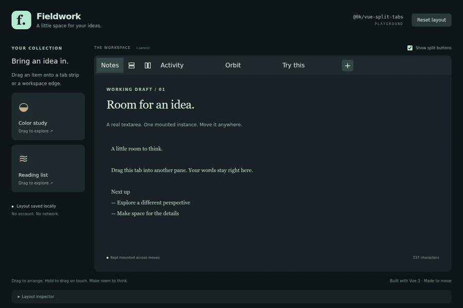
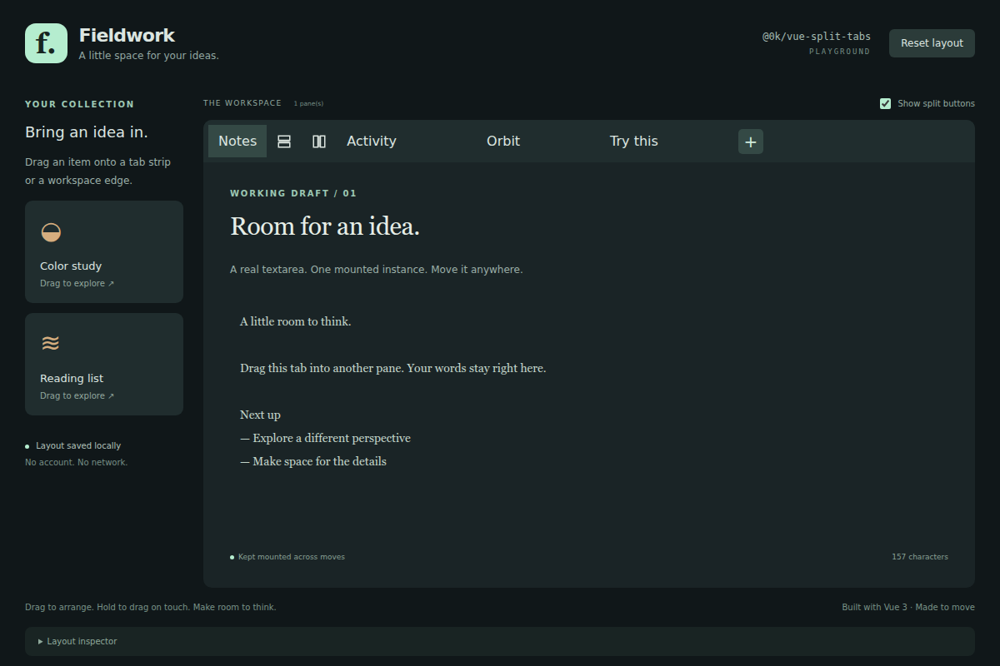
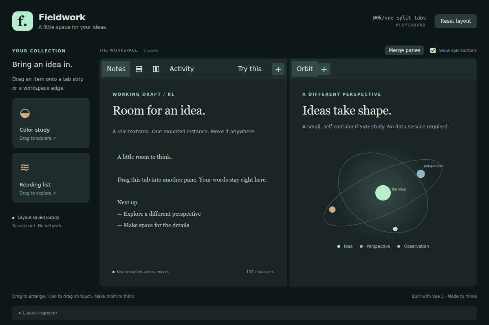
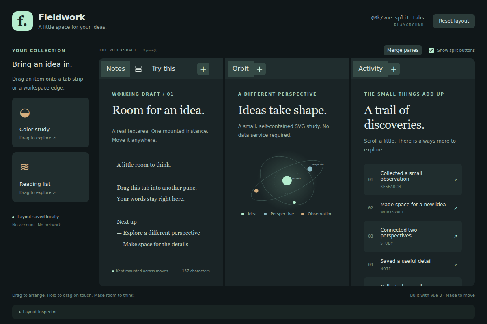
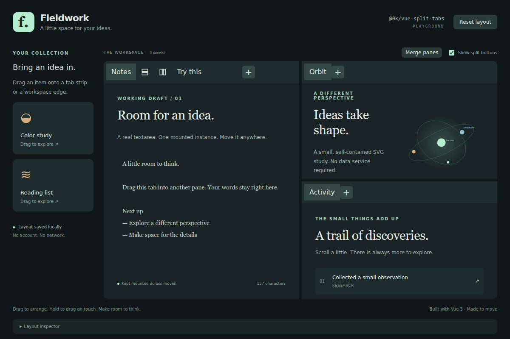
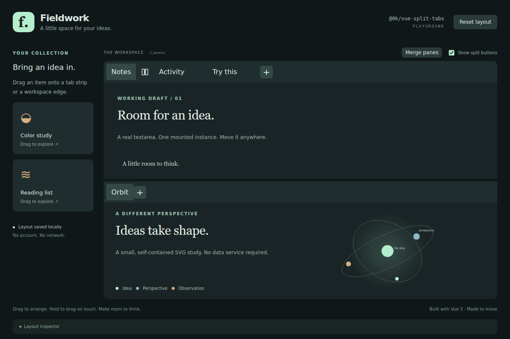
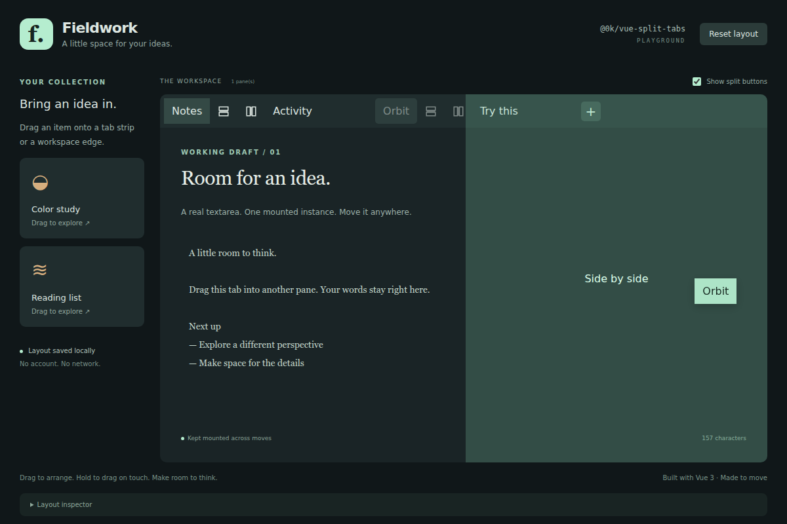
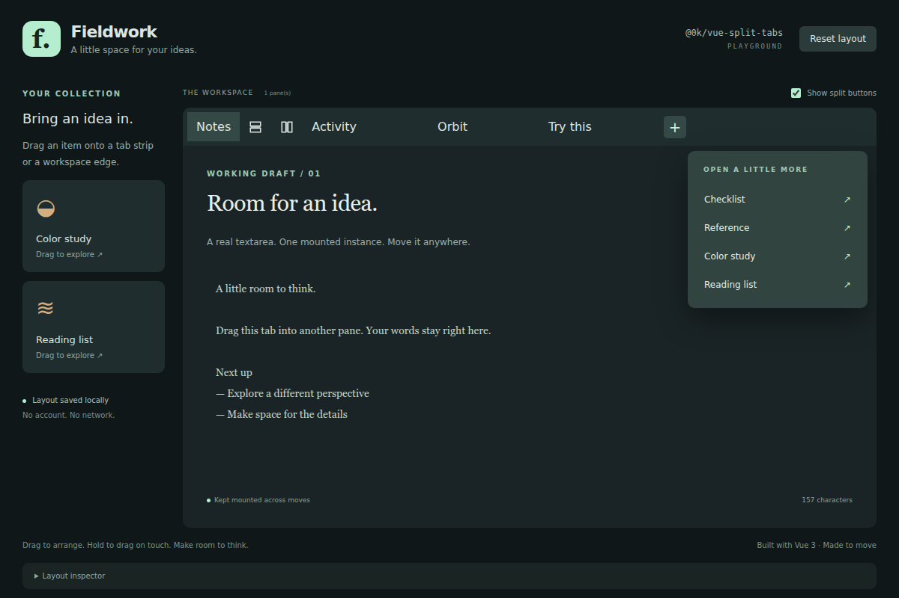
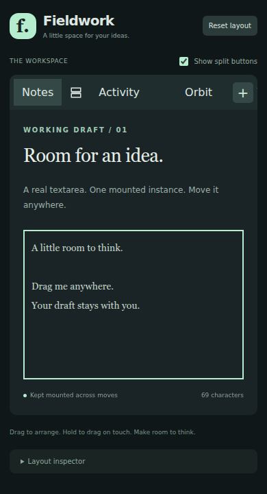

#+TITLE: @0k/vue-split-tabs

* Purpose

=@0k/vue-split-tabs= provides content-agnostic Vue 3 tabs in recursively
resizable panes. Any pane can split again while it fits the host's minimum
size. The controller owns saved intent, effective layout, ordering, selection
and bounded per-page persistence. Components render that layout and handle
gestures. Hosts own content, labels, routing, storage keys and themes.
Persistent content moves through Vue Teleport without remounting.

* Demo

Fieldwork is an offline workspace using the public built package and stylesheet.
Neither ~demo/~ nor ~doc/~ is shipped to npm.

#+begin_src sh
npm run demo
#+end_src

Open the URL printed by Vite. Write in Notes, drag Orbit to the right edge,
then drag Activity to the right edge of Orbit's pane. Double-click either
divider: all three columns become equal. Reset and split the right pane at
its bottom edge to try mixed columns and rows. Narrow the window to collapse
inner cuts first, then enlarge it to restore the saved tree.

The recording includes a nested split and double-click equalization:

** Scenarios

Notes is a real textarea with component-local state and inset focus padding.

Independent side-by-side content:

Three equal columns, including divider widths:

A left column beside a right-hand top/bottom split:

Top/bottom layout and a labelled edge-drop preview:

The + menu opens optional tabs. Checklist demonstrates atomic replacement;
close removes an empty leaf and promotes its sibling without flattening it.

Phone-width collapse keeps the Notes instance and draft:

The sidebar hands armed external pointer drags to the library. Its sources
are pre-registered optional tabs so opened items restore on reload. The host
owns the initial threshold/hold and source click suppression. The library
owns targets, ghost, previews and drop handling. The toolbar hides split
buttons for drag-only use or merges all panes. The inspector shows tree
intent, effective panes and root fit. Reset preserves the Notes draft.
An explicit ~?active=chart~ request demonstrates the host-active binding and
deep links; ~?active=~ preserves an empty selection until a tab is selected.
Host setter calls repair that explicit URL request as well as the demo state.
~?incoming=colors~ demonstrates a genuinely absent, nonoptional sidebar source:
the host registers it only inside the valid-drop insertion handoff.

~demo/App.vue~ renders every pane through one generic slot; ~Notes.vue~ and
~Content.vue~ own content; ~style.css~ owns the demo theme. ~browser.mjs~ owns
the isolated loopback server, browser lifetime and real-input helpers.
~test.mjs~ contains fail-fast acceptance; ~capture.mjs~ regenerates images.
~acceptance.org~ maps S1–S15 and demo contracts to named tests.

* Install and usage

#+begin_src sh
npm install @0k/vue-split-tabs
#+end_src

Vue ~^3.5~ is an external peer. This package is ESM-only. Import CSS once;
the JavaScript and declaration entries do not import it implicitly.

#+begin_src vue

<template>
  <SplitTabs :controller="controller" :labels="{ divider: 'Resize panes' }">
    <template #pane="{ pane }">
      <SplitTabStrip :controller="controller" :pane="pane.id" :labels="labels" />
      <SplitTabsAnchor part="body" />
    </template>
    <template #keep>
      <SplitTabsKeep v-for="tab in tabs" :key="tab" :tab="tab" part="body">
        
{{ tab }} content supplied by the host

      </SplitTabsKeep>
    </template>
  </SplitTabs>
</template>
#+end_src

Give the host container a definite height. Omit ~#pane~ and pass
~:strip-labels="labels"~ for the default strip and body anchor. Without
~stripLabels~, the default is selectable and reorderable but has no
unlabelled controls or edge-drop labels. ~#keep~ is instantiated once.
Unmatched Keep content stays mounted in the hidden holder.

* Behavior contract

** Intent, identity and effective layout

- ~Orientation~ is ~'rows'~ (top/bottom) or ~'cols'~ (side by side).
  ~PaneId~ is a controller-generated stable string, not an ordinal.
  New nodes never reuse ids within a controller lifetime; ids read from stored
  trees are reserved too. Explicit removal drops that leaf's in-memory history.
- Saved intent is ~{ tree, firstActive, order, opened, ratio }~. A
  ~LayoutNode~ is a pane ~{ kind: 'pane', id, tabs, active }~ or cut
  ~{ kind: 'cut', id, orientation, ratio, first, second }~. Depth is not
  artificially limited. Cut ids address divider operations.
- ~panes~ is a flat depth-first list (first before second). Each pane has
  ~id~, positional ~index~, ~tabs~, ~active~, effective pixel ~width~ and
  ~height~, and ~fits: { rows, cols }~. Use ids in actions and component
  props; indices are display-only. ~layout~ is the recursive effective tree:
  either ~{ kind: 'pane', pane }~ or an ~EffectiveCut~ with children,
  orientation, ratio and measured width/height.
- The first leaf receives every visible tab not assigned to another leaf.
  Membership retains absent ids. Optional ids are visible only when opened;
  all other present ids are visible. ~opened~ exposes visible optional ids
  in effective order; saved ~intent.opened~ also retains absent ids.
- ~order~ is page-wide, retaining absent ids. Present saved ids keep custom
  order. Insert a newly present id after its nearest already-placed natural
  predecessor, or at the start. Derivation, size and tab-list changes never
  write storage or reset custom order.
- The first RENDERED pane uses ~active.get/set~, or an internal first-visible-tab ref,
  even when the original first intent leaf has no present visible tabs.
  Preserve an empty host active id. Host deep links into any other leaf show
  there; the first leaf falls back to its own tab. Other leaves remember
  their shown tab. Selection history is memory-only per pane id and entry
  key, learned only by controller actions, never host navigation.
  A nonempty host request that is currently absent/hidden falls back to a valid
  shown tab without changing the host, saved selection or storage. Only an
  explicit empty host request leaves an otherwise nonempty primary pane blank.
- ~firstActive~ records primary controller selections and host setter calls,
  atomically with their action. ~restoredActive~ is a request for the host to
  consume only when it has no explicit navigation request. It is available
  for valid representative-leaf membership of the first rendered pane in split
  intent even while collapsed;
  it never invokes the host setter automatically.
- Fit is top-down. Render a cut only when its axis fits two minimum panes
  plus a divider and both sides have visible tabs. Otherwise show its entire
  subtree as one pane, listing all its tabs in global custom order and
  showing the first leaf's shown tab. Reserve at least one minimum pane per
  side: inner cuts collapse before outer cuts. Intent remains untouched and
  the exact tree restores when space returns. Unmeasured axes fit nothing.
- Divider resize uses the full minimum of each subtree: sum plus dividers
  for same-axis cuts, maximum for cross-axis cuts. Resizing therefore never
  folds an inner split when the full minimum fits. Under pressure, fall back
  to one minimum pane per side. Size clamps are not persisted.

** Actions

Every changed user action persists once. Invalid ids, pane ids, references,
orientations and sides are no-ops. Selection belongs to the effective pane.

- ~open~ focuses an already-visible tab where it is, never moving it. For a
  hidden present optional tab it opens at the destination end and reveals it.
  ~insert~ opens at a strip slot, or uses ~place~ for an already-visible id.
- ~place~ reorders within a pane without selection (current-slot drops are
  no-ops); crossing panes moves and reveals the tab. ~moveTo~ instead puts
  the tab behind the destination's shown tab. Moving to the same pane selects.
- ~split~ splits the target pane, defaulting to the pane containing the tab.
  It retains outer ratio memory. ~splitAt~ uses a centred ratio matching the
  edge preview; ~side~ is ~'start'~ (left/top) or ~'end'~ (right/bottom).
  The dropped tab is alone and revealed on that side. The existing pane must
  retain another visible tab. ~insertSplit~ also opens a hidden present id
  atomically; one existing tab plus the incoming tab is sufficient.
- ~close~ affects visible optional tabs only, retaining their order slot.
  ~replace(oldId,newId)~ is atomic: a hidden present target takes the source's
  slot, membership and opened state; an already-visible target never moves,
  and is focused after dismissing the source. An inactive replacement does
  not change the shown tab. Hosts make temporary placeholders optional.
- A departing shown tab is replaced by that pane's most recently viewed
  remaining tab, else its next order neighbor, then previous neighbor.
  An emptied pane is removed and its sibling subtree takes its parent cut's
  place, retaining all inner ratios. Explicit ~merge()~ produces one pane,
  clears membership and remembered selection, and preserves order, opened
  ids and outer ratio memory. Derived collapse never removes saved leaves.
  Unrelated actions preserve absent tabs' saved assignments in surviving leaves;
  materialization adds current implicit membership without replacing saved absent
  assignments. Automatic sibling promotion retains the survivor's assignments;
  explicit merge remains the membership-reset action.
  All actions preserve unique membership across intent leaves, including moves
  into size-collapsed panes. Removing a host-linked tab/pane repairs host active
  and ~firstActive~ from the resulting tree, in the same single write; the host
  setter observes that persisted selection, not an intermediate tree.
- ~setRatioLive~ changes memory only; ~commitRatio~ clamps and persists.
  A cut's ratio is its first child's fraction after subtracting its divider.
  Without measurement/fit, commit stores the normalized ~[0,1]~ request,
  not the display default. Non-finite ratios use ~defaultRatio~. Collapse
  aborts live resize without a commit and restores committed intent later.
- ~equalize(cutId)~, double-click or focused Enter finds the maximal connected
  same-orientation RENDERED run, walking up and down. Its segments are maximal
  rendered subtrees that are not same-orientation cuts. Empty intent branches
  count as neither segments nor dividers; a size-collapsed nonempty subtree is
  one segment, and its hidden ratios stay untouched. Give those segments equal
  axis sizes accounting for divider widths, subject to EFFECTIVE subtree minimums
  in both allocation and final clamp. A size-collapsed pane contributes one pane
  minimum, even when its hidden intent requires more. Ordinary divider resizing
  continues to use S8 full intent minima; equalization does not alter hidden ratios.
  A lone cut centres; a column beside two nested columns becomes thirds.
  Changed ratios share one persisted write. With no cut id, use the rendered
  root cut; if no cut is rendered, ratio APIs retain their saved-intent fallback.

** Storage

One JSON table under ~storageKey~ holds ~entries~, oldest first, with
~{ key, stamp, intent }~. Default maximum is 50. Existing-entry reads and
changed actions bump monotonic recency; untouched new keys need no entry.
~entryKey~ changes reload synchronously. Before writing, refresh and validate
shared storage; replace only the current entry and stamp above the maximum
local/stored stamp. Failed writes retain memory and pending intent. Never
resurrect stale cached entries over newer persisted ones.

The previous ~orientation/second/secondActive/ratio~ format migrates on read
to an equivalent one-cut tree (or single leaf). Missing ~firstActive~,
~order~ and ~opened~ retain their neutral defaults; empty-string order/opened
is tolerated. Invalid entries are dropped individually; duplicate keys keep
the highest-stamp valid entry (last occurrence on ties). Validate tree ids,
membership and ratios at the boundary. Corrupt JSON and throwing storage
never prevent in-memory use. Default storage is ~window.localStorage~ with
controller-local memory fallback. ~dispose()~ stops watchers.

** Components and gestures

Nested minimum-zero flex containers render one labelled, focusable
~role=separator~ per effective cut, with ~aria-orientation~ and percentage.
Pointer resize uses window listeners, best-effort capture and cut-relative
geometry. Press/release without axis movement commits nothing; actual
pointer up/cancel commits once. Axis arrows step 8px, Shift 32px; Home/End
reach subtree clamps. Enter and double-click equalize.

Strips use ordinary named native buttons with ~aria-pressed~, not ARIA
tablists containing unrelated actions. Host slot text remains the accessible
name. Alt+Shift+Left/Right reorders one slot without selecting and retains
focus. Strips scroll horizontally with nonshrinking, nowrap items.

Every pane offers directly labelled row/column split buttons for its fitting
axes when it has multiple tabs. There is no ambiguous move-to-other button.
~splitButtons: false~ hides only split buttons; close, end slot, keyboard
reorder and drag/drop stay available. Enabled icons keep layout and keyboard
order while hidden with opacity/pointer-events; active, hover or focus reveals
them. Optional close uses ~labels.close~, sits immediately after the label
inside the active title span, and neither selects nor starts a drag.

The optional ~#end~ slot is sticky at the strip's right edge, outside tab
items and excluded from drop targeting/insertion measurements. It does not
change strip visibility; use ~alwaysShow~ for single-tab add controls.

Mouse tab drag starts beyond 6px. Touch/pen first holds 350ms; movement beyond
6px before arming cancels and permits native scrolling. While armed, a
temporary non-passive window ~touchmove~ listener prevents panning. Changing
~touch-action~ after touch start is not sufficient. No HTML5 drag/drop.

Within the same root, strip slots show a midpoint insertion marker. Every
pane's body edge thirds offer fitting left/right or top/bottom splits of
THAT pane; corners choose the nearest normalized edge. The labelled shade
is relative to that pane, not the root. Another pane's body centre offers a
revealing move with full shade and strip-end marker. Own centre, foreign
roots, end slots and non-fitting edges cancel. Ghosts clone host markup,
not component instances; marker coordinates account for scroll/transforms.
Escape/cancel/unmount clean listeners, timers, ghost and previews. Mouse
drag click suppression affects only immediate pointer clicks (~detail > 0~)
and expires after the current task; keyboard activation is never suppressed.

Anchors register by pane id and part. Keep uses deferred Teleport retargeting
and ~v-show~; content never remounts for nested moves, new/removed panes,
collapse or restoration. Only removing the host's Keep unmounts it.
All visible and accessibility labels are host-supplied. There is no imposed
palette, typography or 1px border. Android WebView 91 is the runtime floor.

* API

** Breaking changes from 0.1.x

| Before | After |
|--------+-------|
| PaneIndex = 0 or 1 | PaneId = string; obtain it from pane.id or paneOf(tab) |
| pane.index in place/moveTo/select and strip props | pane.id in every pane-naming API |
| paneOf(tab): PaneIndex or null | paneOf(tab): PaneId or null |
| moveToOther(id) | Removed; moveTo(id, destinationPaneId) |
| split(id, orientation) | split(id, orientation, targetPaneId?) |
| splitAt(id, orientation, side) | Same, plus optional fourth targetPaneId |
| setRatioLive / commitRatio(ratio) | Same, plus optional second cutId (root by default) |
| divider centring | equalize(cutId?) / double-click / Enter equalize connected run |
| intent.orientation / second / secondActive | intent.tree; root orientation via controller.orientation or tree |
| labels.sendToOther | Removed; row/column controls apply to every fitting pane |
| split drop target without pane | Split target includes hovered pane: PaneId |

Existing saved data migrates automatically; hosts must adapt their TypeScript
calls. Do not cache positional indices as pane identities. ~isSplit~ means
more than one rendered pane, not merely saved split intent. Root ~fits~ is
available for overview; use each ~pane.fits~ for programmatic local splits.
~orientation~ is the effective root orientation (null when collapsed).

~pane.fits~ describes *geometric capacity*, not action availability. A one-tab
pane can report ~fits.cols === true~, yet splitting its own only tab is a no-op
because nothing would remain. Importing a tab from another pane (or opening a
hidden optional tab through ~insertSplit~) can split that same pane. Hosts must
consider the incoming tab and remaining membership as well as the fitting axis.

** Controller options

| Option | Type / meaning |
|--------+----------------|
| tabs | Required MaybeRefOrGetter<readonly string[]>; natural order |
| optional | Optional MaybeRefOrGetter<readonly string[]>; hidden until opened |
| active | Optional { get(): string; set(id: string): void } |
| entryKey | Required MaybeRefOrGetter<string>; page identity |
| storageKey | Required string; LRU table key |
| storage | Optional SplitTabsStorage (getItem, setItem, removeItem) |
| maxEntries | Default 50; minimum 1 |
| minPaneWidth / minPaneHeight | Required pixel minimums |
| dividerSize | Default 6px; readonly controller property too |
| defaultRatio | Default 0.5 |

Reactive members (~ComputedRef~): ~intent~, ~layout~, ~panes~, ~isSplit~,
~orientation~, root ~fits~, ~canOfferSplit~ (some pane can split), root
~ratio~, ~restoredActive~, and readonly visible optional ~opened~.
~cuts~ is a ~ComputedRef<ReadonlyMap<string, EffectiveCut>>~ containing current
rendered cut geometry by id. Components use this index for live resize state.
The controller caches subtree tab lists, representatives and axis minimums
independently of geometry, so live ratios and container resizing do not rebuild
or recursively remeasure those facts for every node.

| Method | Signature |
|--------+-----------|
| paneOf | (id: string): PaneId or null |
| isOptional | (id: string): boolean |
| open | (id: string, pane: PaneId): void |
| place | (id: string, pane: PaneId, beforeId: string or null): void |
| insert | (id: string, pane: PaneId, beforeId: string or null, register?: () => void): void |
| split | (id: string, orientation: Orientation, pane?: PaneId): void |
| splitAt | (id: string, orientation: Orientation, side: SplitSide, pane?: PaneId): void |
| insertSplit | (id: string, orientation: Orientation, side: SplitSide, pane?: PaneId, register?: () => void): void |
| moveTo | (id: string, pane: PaneId): void |
| select | (pane: PaneId, id: string): void |
| close | (id: string): void |
| replace | (oldId: string, newId: string): void |
| merge / dispose | (): void |
| setRatioLive / commitRatio | (ratio: number, cut?: string): void |
| equalize | (cut?: string): void |
| setContainerSize | (width: number, height: number): void |

** Components

| Component | Props | Slots / events |
|-----------+-------+----------------|
| SplitTabs | controller; labels: { divider }; optional stripLabels | #pane: { pane }; #keep once |
| SplitTabStrip, controlled | controller; pane: PaneId; labels: { rows, cols, close? } | #tab: { id, active }; #end; select(id) |
| SplitTabStrip, plain | tabs; active | Same slots/event; no controller/icons |
| SplitTabsAnchor | part; inside pane | None |
| SplitTabsKeep | tab; part; inside root | Default persistent content |

Both strips accept ~alwaysShow~, ~splitButtons~ (default true), ~tabClass~
and ~iconClass~. Default strips hide with fewer than two tabs unless split
or alwaysShow. Re-key SplitTabs if replacing the controller instance.
Pane/anchor providers are private.

State hooks: ~split-tab-strip-tab--active~ and ~aria-pressed~;
~split-tab-strip-item--active~; combined ~split-tab-strip-title--active~.
Gesture hooks: ~split-tab-strip--draggable~, ~split-tab-strip-item--drag-armed~,
~split-tab-strip-item--dragging~, ~split-tab-strip-marker~ (~data-before~),
~split-tabs-drag-ghost~, ~split-tabs-pane--drop-target~,
~split-tabs-drop-shade~ (~data-zone~, ~data-orientation~, ~data-side~).
Panes expose ~data-pane-id~ for identity and ~data-split-tabs-pane~ for their
current index. Cuts expose ~data-split-tabs-cut~ and dividers ~data-cut~.

** External drag handoff

The root component ref exposes:

#+begin_src typescript
startExternalDrag(event: PointerEvent, id: string, ghost: ExternalTabGhost,
  labels: { rows: string; cols: string },
  beforeDrop?: (target: TabDropTarget) => void): void
#+end_src

~ExternalTabGhost~ is ~{ label: string }~ or an HTMLElement to clone.
~TabDropTarget~ is either
~{ kind: 'place', pane, beforeId, marker, shade }~ or
~{ kind: 'split', pane, orientation, side, label, marker: null, shade }~.
All pane fields are ids. The already-armed pointer uses the SAME root drag
instance without another threshold or hold. The host stops its recognizer's
listeners at handoff and owns source click suppression. Busy roots ignore
another start. Absent ids may preview targets, including one-tab edge splits.

On valid drop only, synchronous ~beforeDrop(target)~ registers the id in
reactive host tabs through ~insert~ / ~insertSplit~'s optional ~register~ callback.
The controller captures and validates the target projection first, runs
registration, then applies exactly that placement in one intent write. The
incoming id's transient default membership is NOT a real source pane and cannot
resurrect a hidden branch to invalidate the preview. Register it as optional if
it should remain hidden until this atomic insertion. Without the hook it must
already be present at drop time. The callback may register the incoming tab and
its optional classification, but must not change entry keys or invoke other
controller actions. Never return a Promise. Cancellation, foreign roots
and invalid drops never call the hook. Touch hosts arrange their own
pre-handoff scrolling policy; the root prevents touchmove only after handoff.

Published declarations target ~moduleResolution: bundler~. The strict
NodeNext probe still reports the four Vue SFC export-resolution errors;
NodeNext support is not claimed. Relative TS imports use ~.js~ extensions.

* Theming

Set variables on the host/root. Fallbacks inherit neutrally; divider size
follows the controller so measurement and rendering agree.

| CSS variable | Default |
|--------------+---------|
| ~--split-tabs-color~ | inherit |
| ~--split-tabs-background~ | transparent |
| ~--split-tabs-pane-background~ | transparent |
| ~--split-tabs-divider-size~ | controller dividerSize, 6px |
| ~--split-tabs-divider-background~ | transparent |
| ~--split-tabs-divider-active-background~ | currentColor |
| ~--split-tabs-divider-hit-extra~ | 4px each side |
| ~--split-tabs-divider-z-index~ | 1 |
| ~--split-tabs-drop-shade-background~ | rgba(127,127,127,0.2) |
| ~--split-tabs-drop-label-color~ | inherit |
| ~--split-tabs-drop-z-index~ | 3 |
| ~--split-tabs-marker-color~ | currentColor |
| ~--split-tabs-marker-width~ | 3px |
| ~--split-tabs-ghost-background~ | Canvas |
| ~--split-tabs-ghost-color~ | CanvasText |
| ~--split-tabs-ghost-opacity~ | 0.85 |
| ~--split-tabs-ghost-shadow~ | 0 4px 12px rgba(0,0,0,0.2) |
| ~--split-tabs-ghost-z-index~ | 10000 |
| ~--split-tabs-keep-overflow~ | hidden |
| ~--split-tabs-strip-gap~ | 0px |
| ~--split-tabs-strip-padding~ | 0px |
| ~--split-tabs-strip-background~ | transparent |
| ~--split-tabs-strip-end-background~ | inherit |
| ~--split-tabs-strip-end-padding~ | 0 |
| ~--split-tabs-strip-scrollbar~ | thin |
| ~--split-tabs-strip-scrollbar-size~ | 6px |
| ~--split-tabs-drag-opacity~ | 0.5 |
| ~--split-tabs-button-color~ | inherit |
| ~--split-tabs-button-background~ | transparent |
| ~--split-tabs-button-radius~ | 0px |
| ~--split-tabs-button-padding~ | 0.25rem 0.5rem |
| ~--split-tabs-tab-active-background~ | rgba(127,127,127,0.12) |
| ~--split-tabs-button-hover-background~ | rgba(127,127,127,0.08) |
| ~--split-tabs-icon-size~ | 18px |
| ~--split-tabs-icon-hit-size~ | 24px minimum |
| ~--split-tabs-close-size~ | 10px |
| ~--split-tabs-close-hit~ | 18px |
| ~--split-tabs-close-gap~ | 2px |
| ~--split-tabs-icon-visible-opacity~ | 1 |

* Development

~npm run check~ runs unit specifications, strict types, a clean ESM/declaration
build, artifact smoke, consumer type probes, pinned real-browser acceptance,
and demo build/typecheck/browser acceptance. Vue remains external; CSS ships
as an explicit export. Build clears dist first. Dependencies and the pinned
Playwright browser must already be installed. No personal browser profile is
used. The demo runner permits only its ephemeral loopback server; the library
browser runner intercepts requests to built local artifacts. Both close
contexts, browser and server in finally blocks, including on failure.

The legacy two-pane behavioral fixtures resolve their positions to public
pane ids through a test-only adapter; tree specifications exercise the public
controller directly. Existing contracts remain checked except the explicitly
replaced single-split guard, move-to-other controls and divider-centre action.

| Command | Purpose |
|---------+---------|
| ~npm run demo~ | Build library and serve playground |
| ~npm run demo:build~ | Build and typecheck demo against emitted declarations |
| ~npm run demo:test~ | Build demo and run real-input acceptance |
| ~npm run demo:capture~ | Regenerate README PNGs and looping GIF |
| ~npm pack --dry-run~ | Inspect package contents without publishing |

Captures use fixed viewports, fresh storage, local fonts and no network
services. ~FFMPEG~ overrides the ffmpeg executable. The GIF must stay below
3 MB. Review every PNG and extracted GIF frame in ~demo/.capture/~ before
accepting captures. The capture script removes its video; review frames are
ignored and may be removed after inspection. Demo dist and caches are ignored.

Releases use the ~pkg~ workflow: ~package.json~ keeps ~%%version%%~ for tag
substitution; README.md is generated from this Org source at release, never
committed. Release/tag/publish requires explicit authorization.

* License

MIT, see ~LICENSE~.
